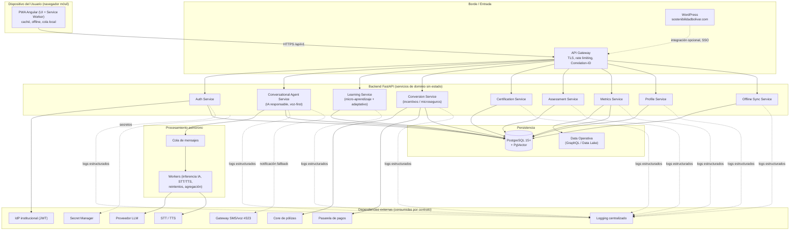
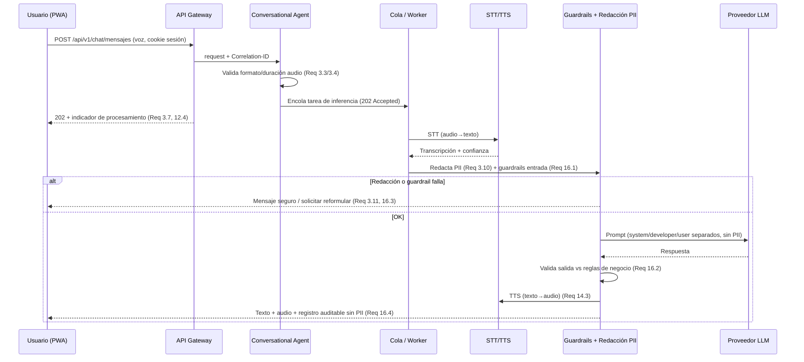

# Documento de Diseño — CIMA (Conocimiento, Inteligencia, Mercado y Agro)

## Overview

CIMA es una **Aplicación Web Progresiva (PWA) ultraligera** que materializa la "Escuela de Sostenibilidad e Inclusión" de Seguros Bolívar. Su objetivo es escalar la educación financiera/climática y la conversión a microseguros entre agricultores y tenderos colombianos, con un costo marginal por interacción muy inferior al de los canales SMS/WhatsApp (Req 12.1).

El diseño responde a tres restricciones duras del público objetivo (edad 40–60, baja alfabetización digital, dispositivos de gama de entrada con almacenamiento limitado, conectividad 3G intermitente):

1. **Fricción mínima de acceso:** autenticación solo con teléfono + Clave de 4 dígitos, sin correo ni descargas (Req 1, Req 2).
2. **Interfaz conversacional voz-first:** un Agente Conversacional de IA generativa que acepta texto y notas de voz y responde con texto y audio (Req 3, Req 14, Req 16).
3. **Operación en condiciones adversas:** carga inicial ≤ 500 KB, TTI ≤ 3 s en 3G, caché agresiva y resiliencia offline con sincronización idempotente (Req 2, Req 18).

### Decisiones tecnológicas clave

| Capa | Tecnología elegida | Justificación (vinculada a requisitos y steering) |
|------|-------------------|---------------------------------------------------|
| Frontend / Presentación | **Angular (LTS)** como PWA (Angular Service Worker, `HttpClient`, RxJS, `inject()`) | Stack aprobado. El Service Worker nativo de Angular cubre caché de recursos y operación offline (Req 2, Req 18). Solo UI, sin lógica de negocio (separación de capas). |
| Backend / Lógica | **FastAPI (Python 3.12+)** con SQLAlchemy, Pydantic, Alembic, pytest | Stack aprobado y **preferido para nuevas APIs Python**. La carga dominante del sistema es IA generativa, STT/TTS, inferencia asíncrona y recuperación por similitud con PgVector; el ecosistema Python/async de FastAPI es el más idóneo. Pydantic impone validación estricta en servidor (Req 7.6, Req 9.2). |
| Persistencia relacional | **PostgreSQL 15+** | Estándar institucional con soporte DBA. Tipado estricto, cifrado at-rest, roles separados. |
| Búsqueda por similitud | **PgVector** (extensión de PostgreSQL) | Habilita el aprendizaje adaptativo por similitud sin introducir una base vectorial dedicada ni cambiar el contrato de API (Req 17.4). |
| Datos operativos consolidados | **GraphQL (Data Operativa / Data Lake)** | Métricas agregadas tolerantes a latencia para el Tablero de Impacto (Req 15), evitando impactar servicios operativos (Req 15.7). |
| Cola / tareas en background | Worker asíncrono + cola de mensajes | Inferencia asíncrona de IA, reintentos de métricas e incentivos, procesamiento de audio (Req 3, Req 5.2, Req 8.4, Req 12.4). |

> Todas las dependencias se anclan a versión exacta (sin `^`, `~`, `*`) y se obtienen desde el repositorio institucional JFrog. Los secretos se gestionan vía Secret Manager / variables de entorno, nunca en código.

## Architecture

CIMA sigue una arquitectura de **microservicios de dominio detrás de un API Gateway**, con separación estricta de capas: la PWA Angular solo renderiza y captura interacción; toda la lógica de negocio, validación y autorización reside en el backend; la persistencia se accede exclusivamente vía API.

### Diagrama de componentes de alto nivel

### Flujo de una interacción conversacional (voz) con IA responsable

### Principios arquitectónicos aplicados

- **Separación de capas:** Angular no contiene reglas de negocio; la lógica de adaptación, el cálculo de puntajes, la selección de microcápsulas y la autorización se ejecutan en el backend (Req 17.3, Req 7.6, Req 15.5).
- **API First:** todas las rutas se versionan con prefijo `/api/v1/`; OpenAPI (generado por FastAPI) es la fuente de verdad del contrato. La evolución a PgVector no cambia el contrato expuesto al frontend (Req 17.4).
- **AI First:** respuestas estructuradas y predecibles; inferencia asíncrona; I/O de IA registrado sin PII; redacción de PII antes del modelo; versionado de modelo; guardrails y kill switch (Req 3, Req 16).
- **Resiliencia:** circuit breakers y timeouts en toda invocación externa; fail-fast en transacciones cortas; procesamiento en background para tareas largas; rate limiting en componentes core (Req 11.5, Req 11.6, Req 12.2–12.5).
- **Observabilidad:** Correlation-ID propagado en cada request; logs estructurados al servicio centralizado (nunca a archivos locales); señales doradas con SLO por servicio y alertas (Req 11).
- **Seguridad por diseño y Zero Trust Input:** toda entrada se valida en servidor; queries parametrizadas; DTOs con allowlist; enmascaramiento de PII en respuestas y logs; cookies httpOnly (nunca tokens en localStorage); SSRF controlado por allowlist de dominios (Req 1, Req 9, Req 10).

## Components and Interfaces

Convención de rutas: `/api/v1/{dominio}/{recurso}`. Toda ruta protegida exige sesión válida (cookie httpOnly) y aplica verificación de propiedad del recurso en el backend (anti-BOLA/IDOR).

### 1. Auth Service — Autenticación sin fricción (Req 1, Req 2.6/2.7, Req 10)

Responsabilidad: registro e ingreso por teléfono (E.164) + Clave de 4 dígitos, hashing de Clave, emisión y rotación de tokens, bloqueo por intentos, expiración por inactividad, SSO con WordPress.

| Endpoint | Método | Descripción | Req |
|----------|--------|-------------|-----|
| `/api/v1/auth/registro` | POST | Crea cuenta si el teléfono no existe; exige doble confirmación de Clave | 1.2, 1.3, 1.4, 1.5 |
| `/api/v1/auth/ingreso` | POST | Autentica y crea sesión; mensaje genérico ante fallo | 1.6, 1.7, 1.11 |
| `/api/v1/auth/refresco` | POST | Rota el token de refresco; emite nuevo access token (≤ 15 min) | 1.10 |
| `/api/v1/auth/clave` | PUT | Cambia la Clave; exige Clave actual | 1.14 |
| `/api/v1/auth/sesion` | GET | Restaura sesión vigente al reabrir la PWA | 2.6, 2.7 |
| `/api/v1/auth/salir` | POST | Invalida la sesión | 1.13 |

Detalles:
- **Texto de ayuda de la Clave (pista mnemotécnica):** en la pantalla de creación de la Clave, el frontend muestra un texto de ayuda en español coloquial que sugiere usar los últimos 4 dígitos del número de cédula como pista para recordarla. Es **solo texto de UI**: el backend **no** valida la Clave contra la cédula ni almacena la cédula. La Clave sigue siendo un secreto con hash (ver *Hashing de Clave*). La cédula **no** se agrega al modelo `profiles` ni se persiste en ninguna entidad (Req 1.3).
- **Hashing de Clave:** algoritmo de hash de contraseñas con sal (bcrypt/argon2 vía `passlib`); nunca texto plano (Req 1.5).
- **Tokens:** access ≤ 15 min + refresh con rotación; cookies `Secure` + `HttpOnly` + `SameSite` (Req 1.10). Sin tokens en localStorage.
- **Bloqueo:** 5 intentos fallidos consecutivos → bloqueo 15 min por teléfono; reactivación con contador en cero (Req 1.11, 1.12). Contador y ventana en almacén con TTL.
- **Inactividad:** sesión invalidada tras 30 min sin actividad (Req 1.13).
- **Mensajería de error:** no revela existencia del teléfono (Req 1.7); textos en español coloquial (Req 1.3, 1.4, 1.8).
- **SSO WordPress:** valida sesión activa de WordPress contra el IdP; si no existe o expiró/>30 min inactividad, redirige a autenticación conservando destino (Req 10.1, 10.2, 2.7).

### 2. PWA / Offline Shell — Angular Service Worker (Req 2, Req 18, Req 13, Req 14)

Responsabilidad: shell de la aplicación, caché de recursos, detección de conexión, cola local de acciones, precarga, accesibilidad y controles de voz.

- **Presupuesto de carga:** bundle inicial ≤ 500 KB; visitas posteriores ≤ 50 KB desde caché (Req 2.3, 2.4). Fallback sin caché descargando por visita (Req 2.5).
- **Service Worker:** estrategia *cache-first* para estáticos y microcápsulas descargadas; *network-first con timeout* para datos dinámicos.
- **Detección de red:** indicador de estado en ≤ 2 s tras detectar interrupción de ≥ 3 s; conserva último paso completado (Req 2.8, 2.9, 18.5).
- **Cola local idempotente:** finalizaciones de microcápsula y respuestas de evaluación offline se encolan con una clave de idempotencia (`client_event_id` UUID v4) y se sincronizan vía Offline Sync Service (Req 18.2, 18.4).
- **Precarga:** siguiente microcápsula de la ruta cuando hay red (Req 18.3).
- **Accesibilidad:** contraste y tamaños WCAG 2.1 AA; objetivos táctiles ≥ 44×44 px CSS; operable a 320 px y 3G; mínimo de pasos (Req 13).
- **Voz-first:** modo primario por voz con texto como alternativa en el mismo flujo; controles de voz ≥ 44×44 px operables con una mano (Req 14.1, 14.4).

### 3. Conversational Agent Service — IA responsable y voz-first (Req 3, Req 14, Req 16)

Responsabilidad: orquestar la conversación por texto/voz, STT/TTS, redacción de PII, guardrails, validación de salida, inferencia asíncrona, registro auditable y kill switch.

| Endpoint | Método | Descripción | Req |
|----------|--------|-------------|-----|
| `/api/v1/chat/mensajes` | POST | Recibe texto (≤ 2000 chars) o nota de voz; encola inferencia; responde 202 | 3.1–3.5, 12.4 |
| `/api/v1/chat/mensajes/{id}` | GET | Consulta el resultado de una inferencia encolada | 3.7, 3.8 |
| `/api/v1/chat/historial` | GET | Historial de la conversación del Usuario autenticado | 3.8 |

Detalles:
- **Validación de entrada:** rechaza texto vacío (tras trim) o > 2000 chars sin invocar el modelo, conservando el contenido (Req 3.2). Rechaza audio fuera de formatos soportados (m4a/aac, ogg, mp3) o > 120 s / < 1 s sin invocar el modelo (Req 3.4).
- **Pipeline IA:** STT → redacción de PII (Req 3.10, 14.6) → guardrails de entrada (Req 16.1) → LLM con mensajes `system`/`developer`/`user` separados → validación de salida vs reglas de negocio (Req 16.2) → TTS (Req 14.3).
- **Confianza y derivación:** STT con confianza < umbral solicita confirmación/repetición sin culpar al Usuario (Req 14.5); respuesta con confianza < umbral o tema sensible deriva a canal humano / respuesta segura (Req 16.3).
- **Tiempos:** respuesta ≤ 15 s; si excede, indicador de procesamiento hasta 60 s; a los 60 s, error de servicio no disponible conservando historial (Req 3.1, 3.7, 3.8).
- **Transparencia:** indica de forma reconocible que es un asistente de IA (Req 16.5).
- **Registro auditable:** entrada redactada, salida, versión del modelo y decisión de guardrail, sin PII, con Correlation-ID (Req 3.9, 16.4).
- **Kill switch:** permite desactivar/degradar el agente ante incidente, con respuesta de respaldo segura (Req 16.6).

### 4. Learning Service — Micro-aprendizaje y adaptativo (Req 4, Req 17)

Responsabilidad: selección y entrega personalizada de microcápsulas, clasificación temática, adaptación por señales de progreso, marcado de ruta completada.

| Endpoint | Método | Descripción | Req |
|----------|--------|-------------|-----|
| `/api/v1/aprendizaje/microcapsulas` | GET | Entrega 1–10 microcápsulas personalizadas por perfil | 4.1–4.5, 4.9 |
| `/api/v1/aprendizaje/microcapsulas/{id}/finalizar` | POST | Registra finalización (idempotente) | 4.6, 4.7, 4.10 |
| `/api/v1/aprendizaje/rutas/{id}` | GET | Estado de la ruta y siguiente paso adaptado | 4.10, 17.1, 17.5 |

Detalles:
- **Selección:** por tipo de cultivo/comercio del perfil; máx. 10 ordenadas por relevancia desc. y fecha desc.; si no hay coincidencias, tema general "adaptación al clima" + notificación (Req 4.3, 4.4, 4.5). Duración de contenido 3–5 min (Req 4.1). Clasificación en exactamente un tema (Req 4.2).
- **Perfil incompleto:** el agente solicita cultivo/comercio hasta 3 veces; si no se obtiene, entrega tema general sin personalización (Req 4.8, 4.9).
- **Adaptación:** repetición, exceso de tiempo o fallo de comprensión → simplifica la siguiente microcápsula; se basa solo en señales ya capturadas; se ejecuta en backend; evoluciona a similitud por PgVector sin cambiar el contrato; default a ruta estándar si no hay señales (Req 17.1–17.5).
- **Completitud de ruta:** marca la ruta como completada cuando todas sus microcápsulas tienen finalización registrada (Req 4.10).

### 5. Conversion Service — Incentivos y microseguros (Req 5)

| Endpoint | Método | Descripción | Req |
|----------|--------|-------------|-----|
| `/api/v1/conversion/incentivos/{rutaId}` | POST | Entrega incentivo al completar 100% de la ruta | 5.1, 5.2, 5.3 |
| `/api/v1/conversion/microseguros` | GET | Presenta 1–5 opciones por tipo de perfil | 5.4, 5.7, 5.8 |
| `/api/v1/conversion/intenciones` | POST | Registra intención de conversión | 5.5, 5.6 |

Detalles:
- Entrega de incentivo ≤ 5 s con confirmación observable; ante fallo, reintenta hasta 3 veces (intervalo ≥ 5 s) conservando completitud; tras 3 fallos marca incentivo pendiente y registra la falla por `profile_id` (Req 5.1–5.3).
- Opciones de microseguro ≤ 3 s según cultivo/comercio; sin perfil, el agente lo solicita; sin oferta, informa y registra ausencia con el tipo solicitado (Req 5.4, 5.7, 5.8).
- Intención de conversión asociada a `profile_id` + ruta; ante fallo informa, no confirma y conserva la opción para reintento (Req 5.5, 5.6).
- Enmascaramiento de PII en toda respuesta de conversión/perfil: máx. últimos 4 caracteres (Req 5.9).

### 6. Certification Service — Certificación (Req 6)

| Endpoint | Método | Descripción | Req |
|----------|--------|-------------|-----|
| `/api/v1/certificados` | POST | Emite certificado si ruta completa y evaluación ≥ 70% (idempotente) | 6.1, 6.2, 6.4 |
| `/api/v1/certificados/{id}` | GET | Devuelve certificado del titular autenticado | 6.5, 6.6, 6.7 |

Detalles:
- Emisión ≤ 5 s con puntaje ≥ 70%; rechazo con mensaje si < 70% (Req 6.1, 6.2).
- Contenido: id de Usuario, id de ruta, fecha ISO-8601, código verificable de 16–64 chars alfanuméricos (Req 6.3).
- Idempotencia: si ya existe para (perfil, ruta), devuelve el existente (Req 6.4).
- Autorización: solo el titular; inexistente → mensaje sin filtrar otros perfiles; no titular → error de autorización + registro del intento con solicitante y fecha ISO-8601 (Req 6.5, 6.6, 6.7).

### 7. Assessment Service — Evaluaciones (Req 7)

| Endpoint | Método | Descripción | Req |
|----------|--------|-------------|-----|
| `/api/v1/evaluaciones/{rutaId}` | GET | Presenta la evaluación al finalizar microcápsulas | 7.1 |
| `/api/v1/evaluaciones/{rutaId}/respuestas` | POST | Valida, calcula puntaje (0–100) y marca aprobado/no aprobado | 7.2–7.7 |

Detalles:
- Validación en servidor de tipo, formato y rango antes de calcular; respuesta inválida → rechazo sin puntaje (Req 7.6, 7.7).
- Umbral por ruta (0–100, default 70); ≥ umbral aprueba; < umbral permite hasta 3 reintentos; agotados → enfriamiento 24 h y reinicio del contador (Req 7.3, 7.4, 7.5).

### 8. Metrics Service + Tablero ODS (Req 8, Req 15)

| Endpoint | Método | Descripción | Req |
|----------|--------|-------------|-----|
| `/api/v1/metricas/eventos` | POST | Registra evento por zona (idempotente, reintentos) | 8.1, 8.2, 8.4 |
| `/api/v1/metricas/reportes` | GET | Reporte agregado por zona (k-anonimato ≥ 5) | 8.5, 8.6, 8.7 |
| `/api/v1/impacto/tablero` | GET | Tablero ODS, solo rol administrativo | 15.1–15.7 |

Detalles:
- Registro ≤ 5 s con tipo, id de zona y timestamp ISO-8601; sin zona → "sin_zona" marcado no clasificado (Req 8.1, 8.2).
- Agregados por zona y tipo con frescura ≤ 60 s; fallo → 3 reintentos + cola de pendientes + error genérico sin pérdida (Req 8.3, 8.4).
- Supresión de zonas con < 5 Usuarios (k-anonimato); sin datos tras supresión → conteo cero + ausencia de datos (Req 8.6, 8.7, 15.4).
- Tablero ODS: solo datos agregados/anonimizados; relación con ODS 8/10/13; autorización de rol en backend; servido desde vista precalculada (vía Data Operativa / GraphQL) para no impactar servicios operativos (Req 15.1–15.7).
- Retención: datos sensibles ≥ 90 días se eliminan/anonimizan conservando solo agregados no identificables (Req 8.8).

### 9. Profile Service — Perfil y protección de datos (Req 9)

| Endpoint | Método | Descripción | Req |
|----------|--------|-------------|-----|
| `/api/v1/perfiles` | POST | Crea perfil con campos mínimos (allowlist) | 9.1, 9.2, 9.3 |
| `/api/v1/perfiles/me` | GET/PUT | Lee/actualiza el perfil del Usuario autenticado | 9.4, 9.5, 9.6 |

Detalles:
- Campos mínimos: teléfono, tipo de cultivo/comercio, zona geográfica; cualquier campo extra → rechazo señalando el campo no permitido (allowlist, Zero Trust) (Req 9.1).
- Normalización (trim) + validación: teléfono 7–15 dígitos, tipo en lista permitida, zona ≤ 100 chars; inválido → rechazo señalando campo, sin crear/modificar (Req 9.2, 9.3).
- Respuestas: DTO autorizado con allowlist, PII enmascarada (máx. últimos 4 chars) en API y logs (Req 9.4, 9.5).
- Anti-BOLA: acceso/modificación a perfil ajeno → error de autorización + registro sin PII; patrón repetido → rate limiting + registro para seguridad (Req 9.6, 9.7).
- Retención: dato sensible a 90 días → eliminación/anonimización no recuperable (Req 9.8).

### 10. Offline Sync Service (Req 18)

Responsabilidad: recibir la cola local, aplicar operaciones de forma idempotente y resolver conflictos conservando el progreso.

| Endpoint | Método | Descripción | Req |
|----------|--------|-------------|-----|
| `/api/v1/sync/acciones` | POST | Aplica lote de acciones offline con clave de idempotencia | 18.2, 18.4 |

Detalles: cada acción trae `client_event_id` (UUID v4); operaciones repetidas no generan duplicados; conflictos se resuelven preservando pasos ya completados (Req 18.2, 18.4).

### 11. Observabilidad y Escalabilidad (transversales, Req 11, Req 12)

- Middleware de Correlation-ID en el API Gateway y en cada servicio; propagación en toda invocación saliente (Req 11.1).
- Logging estructurado (JSON) con redacción al servicio centralizado; nunca a archivos locales (Req 11.2).
- Exposición de señales doradas (latencia, tráfico, errores, saturación) con SLO por servicio y alertas por umbral/burn rate (Req 11.3, 11.4).
- Circuit breaker + timeout + fallback documentado por cada dependencia externa (LLM, voz, pagos, core de pólizas) (Req 11.5, 11.6).
- Servicios sin estado escalables horizontalmente sin pérdida de sesión (sesión en almacén compartido) (Req 12.3); rate limiting en componentes core con respuesta de reintento (Req 12.2, 12.5); tareas largas en background con acuse observable (Req 12.4).

### 12. Gamification Service — Insignias y puntos (Req 19)

Responsabilidad: otorgamiento idempotente de Insignias y puntos al completar una Microcápsula o una Ruta_de_Aprendizaje, ejecución de las reglas de otorgamiento exclusivamente en el backend (nunca en el cliente), validación de elegibilidad de beneficios vinculados a Microseguro, y consulta de reconocimientos con verificación de propiedad del recurso (anti-BOLA/IDOR). Se presenta como servicio de dominio propio para aislar las reglas de gamificación del resto del backend.

| Endpoint | Método | Descripción | Req |
|----------|--------|-------------|-----|
| `/api/v1/gamificacion/reconocimientos` | POST | Otorga Insignia/puntos al completar Microcápsula o Ruta_de_Aprendizaje; idempotente por `client_event_id` e Insignia; reintentos ≤ 3 conservando el evento sin pérdida | 19.1, 19.2, 19.3, 19.5, 19.6 |
| `/api/v1/gamificacion/reconocimientos` | GET | Lista las Insignias y el total de puntos del titular autenticado | 19.7, 19.8 |

Detalles:
- **Enganche con el flujo de completitud:** el Learning Service, al registrar la finalización de una Microcápsula o al marcar una Ruta_de_Aprendizaje como completada (Req 4.6, 4.10), dispara el otorgamiento en este servicio con el `client_event_id` del evento origen; el reconocimiento se refleja de forma visible al Usuario en ≤ 5 s (Req 19.1).
- **Reglas en backend:** la elegibilidad y el cálculo de puntos se resuelven en el servidor; el cliente solo renderiza el resultado (Req 19.3).
- **Beneficios sobre Microseguro:** cuando un reconocimiento conlleva un beneficio sobre un Microseguro, la elegibilidad se valida en el backend —en coordinación con el Conversion Service— antes de aplicar el beneficio; si no se cumple, el beneficio no se aplica (Req 19.4).
- **Idempotencia:** si el Perfil_de_Usuario ya posee la Insignia, no se crea un duplicado y se conserva el registro existente; el total de puntos refleja un único otorgamiento (Req 19.5). Los reintentos reutilizan el `client_event_id` para no duplicar (Req 19.6).
- **Resiliencia:** ante fallo de otorgamiento o registro, reintenta hasta 3 veces y, de persistir, conserva el evento en cola de pendientes sin pérdida de datos (Req 19.6).
- **Autorización:** la consulta verifica la titularidad del Perfil_de_Usuario en el backend; el acceso a reconocimientos ajenos se rechaza con error de autorización, sin revelar Insignias ni puntos de otro perfil y sin exponer PII, registrando el intento (Req 19.7, 19.8).

El servicio se añade al backend FastAPI detrás del API Gateway y persiste en PostgreSQL, siguiendo el mismo patrón que los demás servicios de dominio (nodo lógico `GAM[Gamification Service]`, conectado al Gateway y a PostgreSQL de forma equivalente a los componentes 1–10).

### 13. Survey Service — Encuesta de satisfacción (Req 20)

Responsabilidad: presentar una Encuesta_de_Satisfaccion breve y opcional al completar una Ruta_de_Aprendizaje o un hito definido, validar las respuestas en el servidor (tipo, formato y rango, con calificación en escala 1–5), registrar la respuesta de forma agregada y anonimizada por zona geográfica sin PII, y garantizar la idempotencia de presentación/registro (una vez respondida u omitida, no se vuelve a presentar). Se presenta como servicio/módulo de dominio propio con endpoints claros para aislar las reglas de la encuesta; el registro agregado por zona se coordina con el Metrics Service, consistente con el reporte de métricas existente (k-anonimato ≥ 5).

| Endpoint | Método | Descripción | Req |
|----------|--------|-------------|-----|
| `/api/v1/encuestas/{rutaId}` | GET | Presenta la Encuesta_de_Satisfaccion si no ha sido respondida ni omitida para esa ruta y Usuario (idempotencia de presentación) | 20.1, 20.6 |
| `/api/v1/encuestas/{rutaId}/respuestas` | POST | Valida en servidor (escala 1–5, tipo/formato/rango), registra asociado al Perfil_de_Usuario y zona sin PII; reintentos ≤ 3 conservando la respuesta sin pérdida | 20.3, 20.4, 20.5 |
| `/api/v1/encuestas/reportes` | GET | Reporte agregado de satisfacción por zona geográfica con supresión por k-anonimato ≥ 5 | 20.7 |

Detalles:
- **Enganche con la completitud de ruta:** el Learning Service, al marcar una Ruta_de_Aprendizaje como completada o al alcanzar un hito definido (Req 4.10), habilita la presentación de la encuesta; la encuesta es breve y opcional y se presenta en español coloquial colombiano con al menos una calificación en escala 1–5 (Req 20.1).
- **Respuesta por texto o voz:** la encuesta puede responderse por texto o por voz de forma coherente con la experiencia voz-first, y es omitible sin bloquear el acceso al resto de la plataforma (Req 20.2).
- **Validación en servidor:** cada respuesta se valida (tipo, formato y rango, calificación 1–5) antes de registrar; una respuesta inválida se rechaza indicando el campo inválido y no se registra la encuesta (Req 20.3, 20.4).
- **Registro agregado/anonimizado:** la respuesta válida se registra asociada al Perfil_de_Usuario (seudonimizado) y a la zona geográfica, excluyendo cualquier PII del contenido registrado, en ≤ 5 s; ante fallo de registro reintenta hasta 3 veces y, de persistir, conserva la respuesta en cola de pendientes sin pérdida (Req 20.5, 20.6 reintentos).
- **Idempotencia de presentación/registro:** una vez que la encuesta ha sido respondida u omitida explícitamente para una ruta y Usuario, no se vuelve a presentar ni se registra una respuesta duplicada (restricción `UNIQUE(profile_id, path_id)`) (Req 20.6).
- **Reporte por zona:** el reporte de satisfacción se entrega agregado por zona geográfica sin PII individual, suprimiendo zonas con menos de 5 Usuarios con respuestas registradas, consistente con el reporte de métricas existente (Req 20.7).
- **Retención/anonimización a 90 días:** las respuestas asociadas a datos sensibles con antigüedad ≥ 90 días se eliminan o anonimizan, conservando únicamente los agregados no identificables (Req 20.8).

El servicio se añade al backend FastAPI detrás del API Gateway y persiste en PostgreSQL, siguiendo el mismo patrón que los demás servicios de dominio, y se apoya en el Metrics Service para la agregación por zona.

## Data Models

Tipado estricto en todas las entidades (Pydantic en API, columnas tipadas en PostgreSQL). Solo se almacenan los campos mínimos necesarios. La PII se cifra en reposo y se enmascara en respuestas y logs. Toda clave externa de recurso de Usuario se verifica contra el titular autenticado.

### Perfil_de_Usuario (`profiles`)

| Campo | Tipo | Notas |
|-------|------|-------|
| `id` | UUID v4 (PK) | Identificador interno; nunca se confía en IDs del cliente |
| `phone_e164` | VARCHAR cifrado | 7–15 dígitos; único; PII (enmascarado últimos 4) (Req 9.2, 9.4) |
| `clave_hash` | VARCHAR | Hash con sal (bcrypt/argon2); nunca texto plano (Req 1.5) |
| `activity_type` | ENUM/valor de lista permitida | Tipo de cultivo o comercio (allowlist) (Req 9.2) |
| `geo_zone` | VARCHAR(100) | Zona geográfica; `sin_zona` si ausente (Req 8.2, 9.2) |
| `role` | ENUM(`usuario`,`admin`) | Autorización de Tablero (Req 15.5) |
| `created_at` | TIMESTAMP | Base para retención 90 días (Req 9.8) |

Campos adicionales en la solicitud → rechazo (Req 9.1). Respuestas vía DTO con allowlist (Req 9.5).

### Microcápsula (`microcapsules`)

| Campo | Tipo | Notas |
|-------|------|-------|
| `id` | UUID (PK) | |
| `topic` | ENUM(`gestion_riesgos`,`finanzas`,`adaptacion_clima`) | Exactamente un tema (Req 4.2) |
| `activity_tags` | TEXT[] | Cultivos/comercios asociados (Req 4.3) |
| `duration_sec` | INT | 180–300 (3–5 min) (Req 4.1) |
| `relevance` | NUMERIC | Orden de selección (Req 4.3) |
| `published_at` | TIMESTAMP | Desempate por fecha desc. (Req 4.3) |
| `embedding` | VECTOR (PgVector) | Recuperación por similitud (Req 17.4) |

### Ruta_de_Aprendizaje (`learning_paths`) y progreso (`path_progress`)

| Campo | Tipo | Notas |
|-------|------|-------|
| `id` | UUID (PK) | |
| `microcapsule_ids` | UUID[] | Secuencia ordenada |
| `incentive_id` | UUID (FK) | Incentivo asociado (Req 5.1) |
| `pass_threshold` | INT (0–100) | Default 70 (Req 7.3) |

`path_progress`: `profile_id`, `path_id`, `completed_microcapsules` (set), `completed` (bool, true cuando todas finalizan, Req 4.10), `last_completed_step` (resiliencia, Req 2.8/2.9/18.4).

### Evaluación (`assessments`, `assessment_attempts`)

`assessments`: `id`, `path_id`, `questions` (tipos/rangos esperados para validación servidor, Req 7.6). `assessment_attempts`: `profile_id`, `path_id`, `score` (0–100), `passed` (bool), `attempt_number` (≤ 3), `cooldown_until` (enfriamiento 24 h) (Req 7.2–7.5).

### Certificado (`certificates`)

| Campo | Tipo | Notas |
|-------|------|-------|
| `id` | UUID (PK) | |
| `profile_id` | UUID (FK) | Titular; UNIQUE(`profile_id`,`path_id`) → idempotencia (Req 6.4) |
| `path_id` | UUID (FK) | |
| `issued_at` | TIMESTAMP ISO-8601 | (Req 6.3) |
| `verification_code` | VARCHAR(16–64) alfanumérico | Único verificable (Req 6.3) |

### Incentivo (`incentives`) e IntenciónConversión (`conversion_intents`)

`incentives`: `id`, `path_id`, `type`, `delivery_status` (`entregado`/`pendiente`), `retry_count` (≤ 3) (Req 5.1–5.3). `conversion_intents`: `id`, `profile_id`, `path_id`, `microinsurance_type`, `status`, `created_at` (Req 5.5, 5.6).

### EventoMétrica (`metric_events`) y agregados (`metric_aggregates`)

`metric_events`: `id`, `client_event_id` (UUID v4, idempotencia), `profile_id` (seudonimizado), `geo_zone`, `event_type` (`microcapsula_completada`/`ruta_completada`/`conversion_microseguro`), `timestamp` ISO-8601, `classified` (bool) (Req 8.1, 8.2). `metric_aggregates`: materializado por zona+tipo, frescura ≤ 60 s, k-anonimato ≥ 5 (Req 8.3, 8.6). Datos sensibles ≥ 90 días eliminados/anonimizados (Req 8.8).

### InteracciónIA (`ai_interactions`)

`id`, `correlation_id`, `redacted_input`, `output`, `model_version`, `guardrail_decision`, `stt_confidence`, `created_at`. **Nunca** PII (Req 3.9, 16.4). Audio conservado solo durante la transcripción y luego eliminado/anonimizado (Req 14.6).

### Cola de sincronización offline (cliente)

Estructura local en la PWA: `[{ client_event_id: UUID v4, action_type, payload, enqueued_at }]`. Se envía a `/api/v1/sync/acciones`; la clave de idempotencia evita duplicados en reintentos (Req 18.2).

### Insignia (`badges`) — catálogo

| Campo | Tipo | Notas |
|-------|------|-------|
| `id` | UUID v4 (PK) | Identificador interno de la Insignia |
| `code` | VARCHAR | Código único de la Insignia (UNIQUE) |
| `name` | VARCHAR | Nombre visible al Usuario |
| `criteria_type` | ENUM(`microcapsula`,`ruta`) | Logro que la otorga (Req 19.1) |
| `points_value` | INT | Puntos asociados al otorgamiento (Req 19.2) |

### Insignia otorgada (`user_badges`)

| Campo | Tipo | Notas |
|-------|------|-------|
| `id` | UUID v4 (PK) | |
| `profile_id` | UUID (FK) | Titular; verificado contra el Usuario autenticado (Req 19.2, 19.7) |
| `badge_id` | UUID (FK) | Insignia otorgada |
| `awarded_at` | TIMESTAMP ISO-8601 | Fecha de otorgamiento |
| `client_event_id` | UUID v4 | Clave de idempotencia del evento de otorgamiento; reintentos reutilizan el valor (Req 19.6) |

Restricción `UNIQUE(profile_id, badge_id)` → idempotencia: no se otorga una Insignia duplicada al mismo perfil (Req 19.5).

### Puntos del Usuario (`user_points`)

| Campo | Tipo | Notas |
|-------|------|-------|
| `profile_id` | UUID (PK, FK) | Titular; un registro agregado por perfil |
| `total_points` | INT | Total acumulado de puntos del Perfil_de_Usuario; refleja un único otorgamiento por Insignia (Req 19.2, 19.5) |

### Encuesta_de_Satisfaccion — definición (`surveys`)

| Campo | Tipo | Notas |
|-------|------|-------|
| `id` | UUID v4 (PK) | Identificador interno de la encuesta |
| `path_id` | UUID (FK) | Ruta_de_Aprendizaje o hito que dispara la encuesta (Req 20.1) |
| `questions` | JSONB | Definición de preguntas con tipos/escala para validación en servidor; incluye al menos una calificación en escala 1–5 (Req 20.1, 20.3) |
| `active` | BOOL | Indica si la encuesta está vigente para presentación |

### Respuesta de encuesta (`survey_responses`)

| Campo | Tipo | Notas |
|-------|------|-------|
| `id` | UUID v4 (PK) | |
| `profile_id` | UUID (FK) | Titular; seudonimizado; verificado contra el Usuario autenticado (Req 20.5) |
| `path_id` | UUID (FK) | Ruta_de_Aprendizaje asociada a la encuesta (Req 20.5) |
| `rating` | INT (1–5) | Calificación dentro de la escala permitida 1–5 (Req 20.3) |
| `answers` | JSONB | Estructura validada en servidor (tipo/formato/rango); sin PII en el contenido registrado (Req 20.3, 20.4) |
| `geo_zone` | VARCHAR(100) | Zona geográfica para agregación; `sin_zona` si ausente (Req 20.5, 20.7) |
| `created_at` | TIMESTAMP ISO-8601 | Base para retención/anonimización 90 días (Req 20.8) |
| `client_event_id` | UUID v4 | Clave de idempotencia del registro; reintentos reutilizan el valor (Req 20.6) |

Restricción `UNIQUE(profile_id, path_id)` → idempotencia de presentación/registro: no se presenta ni registra una respuesta duplicada para la misma ruta y Usuario (Req 20.6). El contenido registrado excluye cualquier PII (Req 20.4). Las respuestas sensibles con antigüedad ≥ 90 días se eliminan o anonimizan conservando solo agregados no identificables (Req 20.8).

## Correctness Properties

*Una propiedad es una característica o comportamiento que debe cumplirse en todas las ejecuciones válidas del sistema; es decir, un enunciado formal de lo que el sistema debe hacer. Las propiedades son el puente entre las especificaciones legibles por humanos y las garantías de correctitud verificables por máquina.*

Cada propiedad se implementará con un único test basado en propiedades (property-based testing), mínimo 100 iteraciones, etiquetado con **Feature: cima-plataforma, Property {n}**. Tras la reflexión de propiedades se consolidaron criterios equivalentes (enmascaramiento de PII 5.9/9.4, k-anonimato 8.6/15.4, retención 8.8/9.8, autorización por propiedad 6.5–6.7/9.6) en propiedades únicas para evitar redundancia.

### Property 1: Validación de la Clave de 4 dígitos
*Para toda* cadena de entrada, la creación o cambio de Clave se acepta si y solo si la cadena está compuesta exactamente por 4 dígitos numéricos; cualquier otra cadena se rechaza sin activar ni modificar la cuenta.
**Validates: Requirements 1.4**

### Property 2: Round-trip de hashing de la Clave
*Para toda* Clave válida, el valor almacenado difiere del texto plano, `verify(clave, hash)` es verdadero y `verify(otra_clave, hash)` es falso.
**Validates: Requirements 1.5**

### Property 3: Error de ingreso indistinguible
*Para todo* par de teléfonos (uno registrado y uno no registrado) ante una Clave incorrecta, la respuesta de error es idéntica en código y mensaje, sin revelar la existencia del teléfono.
**Validates: Requirements 1.7**

### Property 4: Bloqueo por intentos fallidos consecutivos
*Para todo* teléfono, acumular 5 intentos fallidos consecutivos produce bloqueo del siguiente intento; con menos de 5 no hay bloqueo; un ingreso exitoso reinicia el conteo a cero.
**Validates: Requirements 1.11**

### Property 5: Reactivación tras expirar el bloqueo
*Para todo* teléfono bloqueado, al transcurrir 15 minutos desde el inicio del bloqueo los intentos se reactivan con el contador de fallos en cero.
**Validates: Requirements 1.12**

### Property 6: Propiedades del token de sesión
*Para toda* emisión de token, la vida del access token no excede 900 segundos y la cookie incluye los atributos Secure, HttpOnly y SameSite.
**Validates: Requirements 1.10**

### Property 7: Validación de longitud del mensaje de texto
*Para toda* cadena de texto, el mensaje se acepta y se procesa si y solo si su longitud tras trim está entre 1 y 2000 caracteres; en caso contrario se rechaza sin invocar el modelo de IA y se conserva el contenido ingresado.
**Validates: Requirements 3.2**

### Property 8: Validación de la nota de voz
*Para todo* audio, se procesa si y solo si su formato pertenece a {m4a/aac, ogg, mp3} y su duración está entre 1 y 120 segundos; en caso contrario se rechaza sin invocar STT ni el modelo de IA.
**Validates: Requirements 3.4**

### Property 9: No fuga de PII hacia el modelo
*Para toda* entrada del Usuario, el contenido enviado al modelo de IA no contiene ninguna PII detectada; si la redacción de PII no se completa con éxito, no se envía contenido alguno al modelo.
**Validates: Requirements 3.10, 3.11, 14.6**

### Property 10: Invariante de duración de microcápsula
*Para toda* microcápsula entregada al Usuario, su duración de contenido está entre 180 y 300 segundos (3–5 minutos), inclusive.
**Validates: Requirements 4.1**

### Property 11: Clasificación temática única
*Para toda* microcápsula, su tema pertenece a exactamente uno de los valores {gestión de riesgos, finanzas, adaptación al clima}.
**Validates: Requirements 4.2**

### Property 12: Selección personalizada acotada y ordenada
*Para todo* catálogo de microcápsulas y perfil con coincidencias, el resultado tiene como máximo 10 elementos, todos corresponden al tipo de cultivo o comercio del perfil, y están ordenados por relevancia descendente y, ante igual relevancia, por fecha de publicación descendente.
**Validates: Requirements 4.3**

### Property 13: Fallback a tema general sin coincidencias
*Para todo* perfil cuyo tipo de cultivo o comercio no tiene microcápsulas coincidentes, el resultado contiene únicamente microcápsulas del tema "adaptación al clima" y se marca una notificación de ausencia de contenido específico.
**Validates: Requirements 4.4, 4.5, 4.9**

### Property 14: Completitud de ruta como bicondicional
*Para toda* Ruta_de_Aprendizaje y Usuario, la ruta se marca como completada si y solo si todas las microcápsulas de la ruta tienen su finalización registrada para ese Usuario.
**Validates: Requirements 4.10**

### Property 15: Resiliencia de registro con reintentos acotados
*Para toda* secuencia de fallos de registro (de finalización de microcápsula o de evento de métrica), el número de reintentos no excede 3 y, de persistir el fallo, el evento se conserva para registro posterior sin pérdida de datos.
**Validates: Requirements 4.7, 8.4**

### Property 16: Invariante de estado de entrega de incentivo
*Para todo* patrón de fallos en la entrega de un incentivo, el estado de completitud de la ruta nunca se pierde, los reintentos no exceden 3 y, tras 3 fallos, el incentivo queda en estado "pendiente" con la falla registrada por identificador de perfil.
**Validates: Requirements 5.1, 5.2, 5.3**

### Property 17: Opciones de microseguro acotadas y pertinentes
*Para todo* perfil con oferta disponible, las opciones de microseguro presentadas son entre 1 y 5 y todas corresponden al tipo de cultivo o comercio del perfil.
**Validates: Requirements 5.4**

### Property 18: Enmascaramiento de PII en respuestas y logs
*Para todo* valor de PII expuesto en una respuesta de API o registro de log, el valor emitido revela como máximo los últimos 4 caracteres y enmascara el resto.
**Validates: Requirements 5.9, 9.4**

### Property 19: Emisión de certificado condicionada al umbral
*Para todo* puntaje de evaluación, el certificado se emite si y solo si el puntaje es igual o superior al umbral de aprobación de la ruta (por defecto 70%).
**Validates: Requirements 6.1, 6.2**

### Property 20: Formato del certificado emitido
*Para todo* certificado emitido, su fecha de emisión es un ISO-8601 válido y su código de verificación es alfanumérico con longitud entre 16 y 64 caracteres.
**Validates: Requirements 6.3**

### Property 21: Idempotencia de emisión de certificado
*Para todo* par (perfil, ruta), emitir el certificado una o varias veces devuelve siempre el mismo certificado, sin crear registros duplicados.
**Validates: Requirements 6.4**

### Property 22: Autorización por propiedad del recurso (anti-BOLA)
*Para todo* par (solicitante, recurso de Usuario), el acceso o modificación se concede si y solo si el solicitante es el titular; en caso contrario se devuelve error de autorización sin revelar el contenido y se registra el intento sin exponer PII.
**Validates: Requirements 6.5, 6.6, 6.7, 9.6**

### Property 23: Puntaje de evaluación y aprobación
*Para todo* conjunto de respuestas válidas y umbral, el puntaje calculado está en el rango [0, 100] y la evaluación se marca aprobada si y solo si el puntaje es mayor o igual al umbral.
**Validates: Requirements 7.2, 7.3**

### Property 24: Reintentos de evaluación y enfriamiento
*Para toda* secuencia de intentos no aprobados, se permiten como máximo 3 reintentos y, al agotarlos, se aplica un enfriamiento de 24 horas tras el cual el contador de intentos se reinicia a cero.
**Validates: Requirements 7.4, 7.5**

### Property 25: Validación de respuestas de evaluación en servidor
*Para toda* respuesta de evaluación, el puntaje se calcula si y solo si la respuesta pasa la validación de tipo, formato y rango; en caso contrario se rechaza sin calcular puntaje.
**Validates: Requirements 7.6, 7.7**

### Property 26: Asignación de zona en eventos de métrica
*Para todo* evento de métrica, si el perfil carece de zona geográfica el evento se asocia a "sin_zona" y se marca como no clasificado; si la tiene, se asocia a esa zona y se marca clasificado, con marca de tiempo ISO-8601.
**Validates: Requirements 8.1, 8.2**

### Property 27: k-anonimato en reportes agregados
*Para todo* reporte agregado por zona o región, ninguna zona o región con menos de 5 Usuarios distintos con eventos registrados aparece en el reporte.
**Validates: Requirements 8.6, 15.4**

### Property 28: Reportes sin PII individual
*Para todo* reporte de métricas o del Tablero de Impacto, el resultado no contiene ningún campo que permita identificar a un Usuario individual.
**Validates: Requirements 8.5, 15.3**

### Property 29: Retención de datos sensibles a 90 días
*Para todo* dato sensible con antigüedad igual o superior a 90 días, tras el proceso de retención deja de ser recuperable como PII, conservándose únicamente agregados no identificables.
**Validates: Requirements 8.8, 9.8**

### Property 30: Allowlist de campos del Perfil
*Para toda* solicitud de creación o actualización de perfil, se rechaza señalando el campo no permitido si y solo si la solicitud contiene al menos una clave fuera del conjunto {teléfono, tipo de cultivo o comercio, zona geográfica}.
**Validates: Requirements 9.1**

### Property 31: Normalización y validación de campos del Perfil
*Para toda* entrada destinada al perfil, tras normalizar con trim se acepta si y solo si el teléfono tiene entre 7 y 15 dígitos numéricos, el tipo pertenece a la lista permitida y la zona no excede 100 caracteres; en caso contrario se rechaza sin crear ni modificar el perfil, señalando el campo inválido.
**Validates: Requirements 9.2, 9.3**

### Property 32: DTO con allowlist en respuestas de Perfil
*Para toda* respuesta de API que incluye datos del perfil, el conjunto de campos expuestos es exactamente el definido en el DTO autorizado para esa respuesta, omitiendo cualquier otro campo.
**Validates: Requirements 9.5**

### Property 33: Rate limiting en componentes core
*Para toda* ráfaga de solicitudes que supera el límite de tasa configurado, las solicitudes dentro del límite se procesan y las excedentes se rechazan con una indicación de reintento, registrando el evento sin exponer PII.
**Validates: Requirements 9.7, 12.2, 12.5**

### Property 34: Control de SSRF en consumo externo
*Para toda* URL de destino, la comunicación se permite si y solo si el dominio está en la lista de permitidos, el esquema es HTTPS y el destino no resuelve a una IP privada o de enlace local; en cualquier otro caso se bloquea sin transmitir datos y se registra el intento con su Correlation-ID.
**Validates: Requirements 10.4, 10.5**

### Property 35: Propagación del Correlation-ID
*Para toda* petición entrante, cada invocación saliente asociada incluye un Correlation-ID; si la petición entrante ya traía uno, se conserva sin cambios a lo largo de toda la cadena.
**Validates: Requirements 11.1**

### Property 36: Idempotencia de la sincronización offline
*Para todo* lote de acciones offline, aplicarlo una o varias veces produce el mismo estado del servidor que aplicarlo exactamente una vez, sin generar registros duplicados (idempotencia por `client_event_id`).
**Validates: Requirements 18.2**

### Property 37: Fusión monótona de progreso sin pérdida
*Para todo* par de estados (local, servidor) de progreso de ruta, el estado resultante de la sincronización contiene la unión de los pasos completados de ambos, sin perder ningún paso ya completado.
**Validates: Requirements 18.4**

### Property 38: Ramificación por confianza de STT
*Para todo* valor de confianza de transcripción, si es inferior al umbral configurado el sistema solicita confirmación o repetición en lenguaje simple; si es igual o superior, procesa la intención resultante.
**Validates: Requirements 14.5**

### Property 39: Guardrails de entrada y validación de salida de IA
*Para toda* entrada insegura, fuera de dominio o que induzca decisiones financieras indebidas, el sistema la bloquea antes de generar respuesta; y *para toda* oferta de microseguro o incentivo generada, se valida contra las reglas de negocio y no se presenta si la validación falla.
**Validates: Requirements 16.1, 16.2**

### Property 40: Registro auditable de IA sin PII
*Para toda* interacción con el Agente_Conversacional, el registro auditable incluye la entrada redactada, la salida, la versión del modelo y la decisión del guardrail, y no contiene ninguna PII.
**Validates: Requirements 3.9, 16.4**

### Property 41: Idempotencia del otorgamiento de insignias
*Para toda* secuencia de solicitudes de otorgamiento de una misma Insignia a un mismo Perfil_de_Usuario, el resultado es a lo sumo un registro de esa Insignia (no se crean duplicados) y el total de puntos refleja un único otorgamiento.
**Validates: Requirements 19.5**

### Property 42: Autorización por propiedad en consulta de reconocimientos
*Para todo* Usuario y conjunto de reconocimientos, la consulta devuelve únicamente las Insignias y puntos cuyo `profile_id` coincide con el Usuario autenticado; el acceso a reconocimientos de otro Perfil_de_Usuario se rechaza con error de autorización sin exponer PII.
**Validates: Requirements 19.7, 19.8**

### Property 43: Validación en servidor de la respuesta de encuesta
*Para toda* respuesta de encuesta, se registra si y solo si cada respuesta cumple el tipo, formato y rango esperados (p. ej. la calificación dentro de la escala 1–5); en caso contrario se rechaza sin registrar, indicando el campo inválido.
**Validates: Requirements 20.3**

### Property 44: Idempotencia de presentación/registro de la encuesta
*Para toda* Ruta_de_Aprendizaje y Usuario, una vez que la encuesta ha sido respondida u omitida explícitamente, no se vuelve a presentar ni se registra una respuesta duplicada para esa misma ruta y Usuario.
**Validates: Requirements 20.6**

## Error Handling

Principio: **errores genéricos al cliente, detalle completo solo interno.** Ningún error expone PII, secretos ni trazas de pila al Usuario (Req 9.4, 11.6).

- **Formato de error al cliente:** cuerpo JSON con `detail` genérico en español coloquial y un `correlation_id` para soporte; nunca stack traces (Req 3.4, 11.2).
- **Manejador global:** captura excepciones no controladas, registra el detalle con Correlation-ID en el servicio centralizado y responde 500 genérico (Req 11.2).
- **Validación (422/400):** Pydantic valida en el borde del servicio; respuestas señalan el campo inválido sin filtrar datos sensibles (Req 7.7, 9.3, 9.1).
- **Autorización (403):** verificación de propiedad del recurso antes de cualquier operación; el fallo registra el intento sin PII (Req 6.7, 9.6).
- **Autenticación (401 / bloqueo):** mensajes que no revelan existencia del teléfono; bloqueo temporal tras 5 fallos (Req 1.7, 1.11).
- **Reintentos y backoff:** finalización de microcápsula, métricas e incentivos reintentan hasta 3 veces y conservan el evento en cola de pendientes ante fallo persistente (Req 4.7, 5.2, 8.4).
- **Circuit breaker + timeout + fallback:** toda invocación a dependencia externa (LLM, STT/TTS, pagos, core de pólizas) aplica timeout bajo, circuit breaker y un fallback documentado; su activación se registra con Correlation-ID sin PII (Req 11.5, 11.6).
- **Degradación controlada de IA:** ante indicador de procesamiento > 60 s o incidente, se muestra error de servicio no disponible / respuesta de respaldo segura conservando el historial, y es posible activar el kill switch (Req 3.8, 16.3, 16.6).
- **Red / offline:** indicador de estado de conexión en ≤ 2 s; acciones encoladas localmente y sincronizadas idempotentemente al reconectar (Req 2.8, 18.2, 18.5).

## Testing Strategy

El sistema combina pruebas basadas en propiedades (lógica de negocio con propiedades universales) y pruebas por ejemplo/integración (comportamiento concreto, infraestructura y dependencias externas). PBT aplica aquí porque gran parte del dominio es lógica pura o determinista con entradas variadas (validaciones, selección, puntajes, enmascaramiento, idempotencia, autorización). No se aplica PBT a performance (presupuestos de bundle, TTI), accesibilidad visual, ni a la verificación de servicios externos.

### Pruebas basadas en propiedades (property-based)
- **Librería:** Hypothesis (Python/backend) para FastAPI; `fast-check` (TypeScript) para la lógica pura del frontend Angular, ejecutado con Jest.
- No se implementa PBT desde cero; se usan las librerías anteriores.
- **Mínimo 100 iteraciones** por propiedad.
- Cada test etiquetado con comentario **Feature: cima-plataforma, Property {n}: {texto}** y referenciando el requisito validado.
- Un test de propiedades por cada propiedad de la sección anterior (Property 1–44).
- Dependencias externas (LLM, STT/TTS, pagos, core de pólizas) se **mockean** para aislar la lógica y abaratar las 100+ iteraciones.

### Pruebas unitarias (por ejemplo)
- **Backend:** pytest + httpx para endpoints y casos concretos/edge (p. ej. latencia de registro ≤ 5 s con reloj simulado, Req 4.6; mensajes de error en español coloquial).
- **Frontend:** Jest + Angular Testing utilities para componentes, Service Worker y cola offline.
- Enfocadas en ejemplos representativos, puntos de integración entre componentes y casos de error; se evita duplicar lo que cubren las propiedades.

### Pruebas de integración
- SSO con WordPress y restauración de sesión (Req 10.1, 10.2, 2.6, 2.7).
- Circuit breaker/timeout/fallback con mocks de dependencias que fallan o exceden timeout (Req 11.5, 11.6).
- Escalado horizontal sin pérdida de sesión con almacén compartido entre instancias (Req 12.3).
- Flujo end-to-end voz: STT → redacción → guardrails → LLM → TTS con mocks (Req 3, Req 14, Req 16).

### Accesibilidad y performance
- **Accesibilidad:** axe-core/Lighthouse para contraste y roles WCAG 2.1 AA; verificación de objetivos táctiles ≥ 44×44 px (Req 13.2, 13.3, 14.4). La conformidad completa WCAG requiere además pruebas manuales con tecnologías de asistencia y revisión experta.
- **Performance budget:** budgets de Angular en build para bundle inicial ≤ 500 KB y posterior ≤ 50 KB (Req 2.3, 2.4); Lighthouse con throttling 3G para TTI ≤ 3 s (Req 2.2); medición de carga integrada ≤ 1 MB (Req 10.3).

### Cobertura y calidad
- Cobertura mínima **80% en lógica de negocio** (SonarQube), cero issues críticos/bloqueantes, complejidad ciclomática ≤ 15 por método.
- Todos los mocks reemplazan dependencias externas; ningún test consume backends reales.
- Colecciones Postman por operación en `postmanCollections/`.

## Security Considerations

Mapeo a OWASP Top 10 y a los principios del steering institucional.

| Riesgo / control | Diseño | Req |
|------------------|--------|-----|
| **A01 Broken Access Control (BOLA/IDOR)** | Autorización siempre en backend; verificación de propiedad del recurso en cada request; nunca se confía en IDs del cliente; registro de intentos no autorizados sin PII; reglas de gamificación y elegibilidad de beneficios resueltas solo en backend | 6.5–6.7, 9.6, 9.7, 15.5, 15.6, 19.3, 19.4, 19.7, 19.8 |
| **A02 Fallos criptográficos** | Clave con hash + sal (bcrypt/argon2); cifrado at-rest (AES-256) de PII; TLS en tránsito; cookies Secure/HttpOnly/SameSite; sin tokens en localStorage | 1.5, 1.10 |
| **A03 Inyección** | SQLAlchemy con queries parametrizadas; nunca concatenación de SQL ni `.raw()` con entrada sin sanear; validación Pydantic en servidor | 7.6, 9.2, 9.3 |
| **A04 Diseño inseguro** | Seguridad por diseño; Zero Trust Input; allowlist de campos y de dominios; fail-fast | 9.1, 10.4 |
| **A05 Configuración incorrecta** | Headers HSTS, CSP (bloqueo de scripts inline), `X-Content-Type-Options: nosniff`, `X-Frame-Options`, `Referrer-Policy`, `Permissions-Policy`; métodos HTTP no usados bloqueados | 11, 13 |
| **A07 Fallos de identificación/autenticación** | Tokens de vida corta + rotación de refresco; rate limit + bloqueo por intentos; expiración por inactividad; sin revelar existencia de cuenta | 1.7, 1.10–1.13 |
| **A08 Integridad de software/datos** | Dependencias ancladas a versión exacta desde JFrog; `pip-audit` en pipeline; SBOM | — |
| **A09 Fallos de logging** | Logs estructurados a servicio centralizado con redacción; nunca a archivos locales; nunca PII/secretos/tokens; Correlation-ID | 11.1, 11.2, 16.4 |
| **A10 SSRF** | Allowlist de dominios, HTTPS obligatorio, bloqueo de IPs privadas y link-local, timeout ≤ 5 s, máx. 2 redirecciones | 10.4, 10.5 |
| **OWASP LLM** | Separación de mensajes system/developer/user; redacción de PII antes del modelo; guardrails de entrada; validación de salida vs reglas de negocio; versionado de modelo; kill switch; transparencia de IA | 3.9–3.11, 16.1–16.6 |

Controles adicionales:
- **Habeas Data / enmascaramiento de PII:** respuestas y logs enmascaran PII (máx. últimos 4 caracteres); DTOs con allowlist exponen solo campos autorizados (Req 5.9, 9.4, 9.5).
- **Minimización y retención:** solo campos mínimos del perfil; datos sensibles eliminados o anonimizados a los 90 días (Req 9.1, 8.8, 9.8).
- **k-anonimato:** supresión de zonas/regiones con menos de 5 Usuarios para prevenir reidentificación (Req 8.6, 15.4).
- **Gestión de secretos:** Secret Manager / variables de entorno; nunca en código ni en el repositorio.
- **Roles de base de datos separados** (lectura/escritura/admin) por servicio; nunca `root` en producción.

## Trazabilidad de requisitos

Los 20 requisitos quedan cubiertos por el diseño: la arquitectura y los componentes de dominio (Secciones Arquitectura y Componentes) cubren Req 1–20 —la gamificación se cubre con el Gamification Service (componente 12, Req 19) y la encuesta de satisfacción con el Survey Service (componente 13, Req 20)—; los modelos de datos soportan Req 1, 4–9, 14, 18, 19, 20 (`badges`, `user_badges`, `user_points` para Req 19; `surveys`, `survey_responses` para Req 20); las 44 propiedades de correctitud validan los criterios testeables de Req 1, 3–11, 14, 15, 16, 18, 19, 20 (Property 41–42 para Req 19.5, 19.7, 19.8; Property 43–44 para Req 20.3, 20.6); el manejo de errores cubre Req 2, 3, 4, 5, 8, 11, 16, 18, 19, 20 (reintentos ≤ 3 y autorización en reconocimientos, Req 19.6/19.8; reintentos ≤ 3 en registro de encuesta, Req 20.6); y las consideraciones de seguridad cubren Req 1, 3, 6, 8, 9, 10, 11, 15, 16, 19, 20 (reglas en backend y autorización por propiedad, Req 19.3/19.4/19.7/19.8; registro sin PII y k-anonimato de la encuesta, Req 20.4/20.5/20.7/20.8). Los criterios no amenables a PBT (performance Req 2.2/2.3/2.4/10.3, accesibilidad Req 13, resiliencia de infraestructura Req 11.5/11.6/12.3) se cubren con pruebas de budget, accesibilidad e integración según la Estrategia de pruebas.
