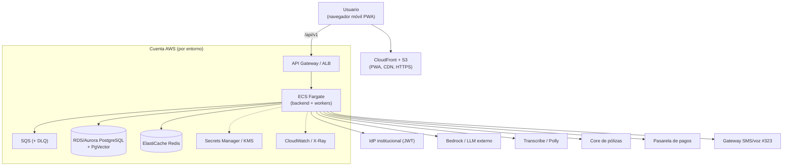
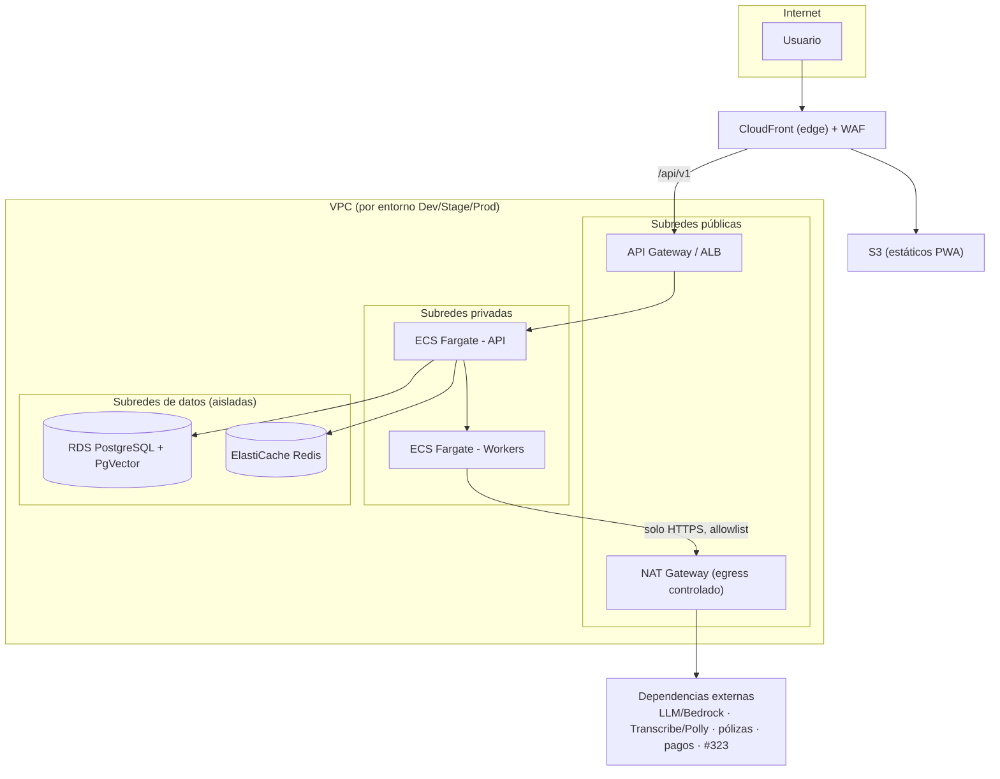
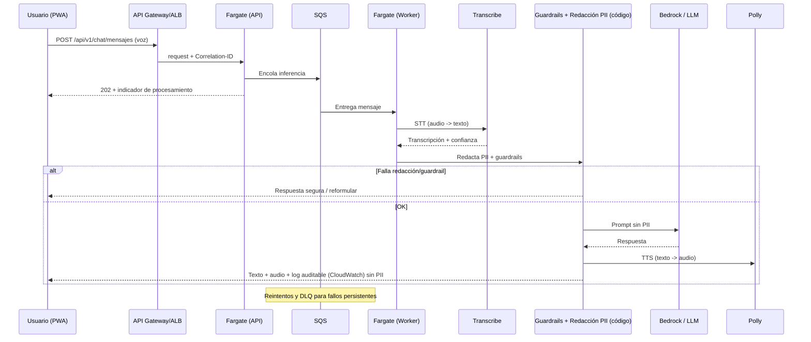

# Arquitectura en AWS — CIMA (Conocimiento, Inteligencia, Mercado y Agro)

Vista de infraestructura de la plataforma CIMA sobre servicios de AWS. Mapea la
arquitectura lógica (`docs/ARCHITECTURE.md` y `.kiro/specs/cima-plataforma/design.md`)
a servicios gestionados concretos.

> **Propuesta de referencia, no decisión definitiva.** Los servicios específicos deben
> ser validados por el equipo de TI/Cloud y gobernados por los steering de IaC (Terraform).
> Supuestos tomados por defecto (ver §7): cómputo con **ECS Fargate**; LLM/voz con
> **Amazon Bedrock + Transcribe/Polly**, con alternativa de **proveedor institucional externo**.

## 1. Principios que se preservan

La arquitectura AWS respeta las decisiones del diseño:

- **Separación de capas:** S3/CloudFront solo sirve la PWA; la lógica vive en el backend
  (Fargate); la BD solo se accede desde el backend dentro de la VPC.
- **Zero Trust / seguridad por diseño:** RDS en subredes privadas sin acceso público;
  egress controlado para SSRF; secretos en Secrets Manager; cifrado at-rest y TLS.
- **AI First:** redacción de PII, guardrails y registro auditable en el backend **antes**
  de invocar el modelo; nunca PII hacia el LLM.
- **Resiliencia:** SQS para asíncrono y reintentos (con DLQ); escalado horizontal sin estado.
- **Observabilidad:** logs estructurados y métricas centralizadas; tracing con Correlation-ID.
- **Entornos Dev/Stage/Prod físicamente separados** (cuentas o VPCs separadas).

## 2. Mapeo de componentes -> servicios AWS

| Componente CIMA | Servicio AWS | Rol | Req |
|---|---|---|---|
| PWA Angular (estáticos) | **S3 + CloudFront** | Hosting PWA, CDN, caché de borde, HTTPS, compresión | R2, R13 |
| API Gateway | **Amazon API Gateway** / **ALB** | Entrada, rate limiting, headers de seguridad, enrutado `/api/v1` | R11, R12 |
| Backend FastAPI (dominio, sin estado) | **ECS Fargate** | Contenedores sin estado, escalado horizontal | R12 |
| Workers async (IA, STT/TTS, reintentos) | **ECS Fargate (worker)** | Procesamiento en background | R3, R12 |
| Cola de mensajes | **Amazon SQS** (+ **SNS** fan-out) | Inferencia asíncrona, reintentos, DLQ | R3, R5, R8 |
| PostgreSQL 15+ con PgVector | **Amazon RDS / Aurora PostgreSQL** | Relacional + similitud (pgvector) | R4, R17 |
| Sesión / rate limit / lockout | **Amazon ElastiCache (Redis)** | Sesión compartida, TTLs, bloqueo de intentos | R1, R12 |
| Secretos | **AWS Secrets Manager** / SSM | Credenciales, claves; nunca en código | R9, R11 |
| Logging centralizado | **CloudWatch Logs** (o Datadog) | Logs estructurados, sin archivos locales | R11 |
| Métricas / SLOs / alertas | **CloudWatch Metrics + Alarms** (o Datadog) | Señales doradas, alertas por umbral/burn rate | R11 |
| Tracing (Correlation-ID) | **AWS X-Ray** (o Datadog APM) | Trazabilidad distribuida | R11 |
| LLM | **Amazon Bedrock** / proveedor externo | Inferencia generativa (sin PII) | R3, R16 |
| STT / TTS | **Amazon Transcribe / Amazon Polly** | Voz a texto / texto a voz | R14 |
| Data Operativa (GraphQL) | **AppSync** + **S3/Athena/Lake Formation** | Agregados del Tablero ODS | R15 |
| Audio temporal / assets | **S3** | Audio solo durante transcripción; luego se borra | R14 |
| Jobs de retención 90 días | **EventBridge Scheduler + Lambda** | Eliminación/anonimización de PII | R8, R9, R20 |
| Cifrado | **AWS KMS** | At-rest (AES-256) para RDS, S3, Secrets | R9 |
| IdP institucional (JWT) | **externo** (por contrato) | No se reemplaza salvo decisión institucional | R1, R10 |
| Red / SSRF | **VPC + Security Groups + egress controlado** | Llamadas externas solo a dominios permitidos, HTTPS | R10 |

## 3. Contexto en AWS

## 4. Despliegue en VPC (subredes públicas / privadas)

- **RDS y Redis** en subredes de datos aisladas, sin ruta a internet.
- **Egress solo por NAT** con allowlist de dominios y bloqueo de IPs privadas (SSRF, R10).
- **WAF** en CloudFront para protección de borde (opcional, recomendado).

## 5. Flujo asíncrono de IA (voz) sobre AWS

## 6. Seguridad en AWS (vista transversal)

| Preocupación | Implementación AWS | Req |
|---|---|---|
| Cifrado at-rest | KMS en RDS, S3, Secrets, ElastiCache (AES-256) | R9 |
| Cifrado en tránsito | TLS en CloudFront, ALB, RDS | R9 |
| Secretos | Secrets Manager; rotación; nunca en imagen/código | R9, R11 |
| Autorización | En el backend (anti-BOLA); IAM entre servicios AWS | R6, R9, R19 |
| SSRF | Egress por NAT con allowlist; SG restrictivos | R10 |
| Red | RDS/Redis en subredes privadas sin IP pública | R9 |
| PII / Habeas Data | Enmascaramiento en app; retención 90 días vía EventBridge+Lambda | R8, R9, R20 |
| IA responsable | Redacción/guardrails en app antes de Bedrock; Bedrock Guardrails como capa extra | R16 |
| Cabeceras / borde | CloudFront + WAF; HSTS, CSP, nosniff vía gateway | R11 |
| Separación de entornos | Cuentas/VPCs separadas Dev/Stage/Prod | Gobierno TI |

## 7. Supuestos y alternativas (a validar por TI/Cloud)

| Decisión | Por defecto en este doc | Alternativa |
|---|---|---|
| Cómputo backend | **ECS Fargate** (menos operación) | **EKS** si ya hay estándar Kubernetes |
| LLM | **Amazon Bedrock** | **Proveedor institucional externo** consumido por contrato |
| STT/TTS | **Transcribe / Polly** | Proveedor de voz institucional |
| Entrada | **API Gateway** | **ALB** si se requiere menor costo por volumen |
| Observabilidad | **CloudWatch + X-Ray** | **Datadog** (según steering de observabilidad) |
| Base de datos | **RDS PostgreSQL** | **Aurora PostgreSQL** si se necesita mayor escalado/HA |

> El stack de aplicación (FastAPI, Angular, PostgreSQL/PgVector) no cambia: AWS solo
> provee la infraestructura gestionada. Si existe un proveedor LLM/voz institucional,
> se mantiene y AWS aporta cómputo, datos, red y observabilidad.

## 8. Trazabilidad

| Artefacto | Ubicación |
|---|---|
| Requisitos (EARS) | `.kiro/specs/cima-plataforma/requirements.md` |
| Diseño técnico | `.kiro/specs/cima-plataforma/design.md` |
| Arquitectura lógica | `docs/ARCHITECTURE.md` |
| Arquitectura en AWS (este documento) | `docs/ARCHITECTURE-AWS.md` |
| Plan de implementación | `.kiro/specs/cima-plataforma/tasks.md` |
