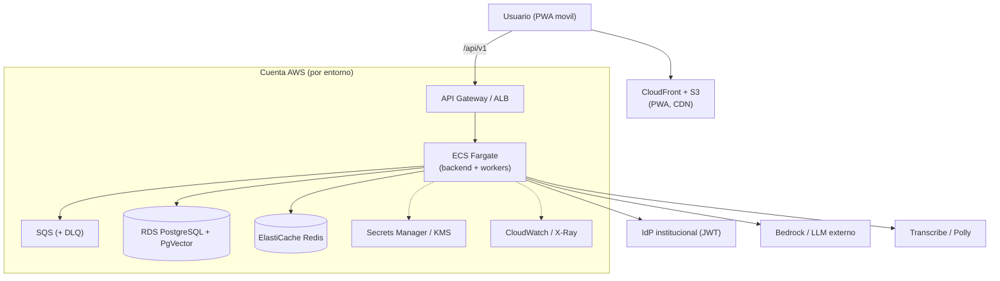
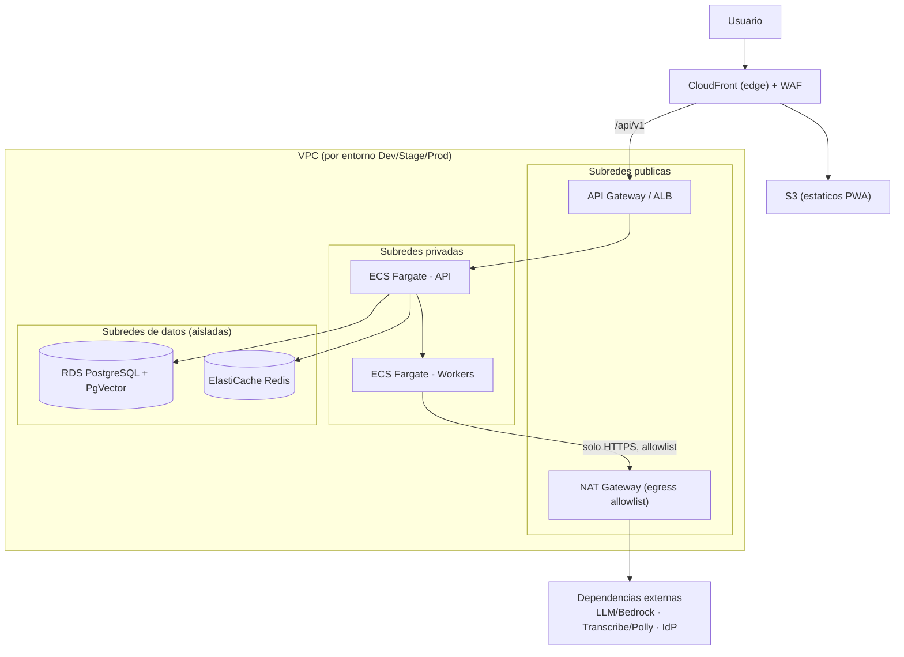
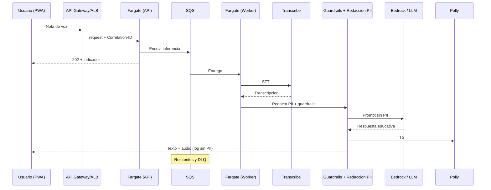

# Arquitectura en AWS — CIMA (plataforma educativa)

Vista de infraestructura de CIMA sobre servicios de AWS. Mapea la arquitectura lógica
(`docs/ARCHITECTURE.md`) a servicios gestionados. CIMA es una **plataforma educativa**:
**no procesa pagos ni emite pólizas**.

> **Propuesta de referencia, no decisión definitiva.** Los servicios finales los valida
> TI/Cloud y los gobiernan los steering de IaC (Terraform). Supuestos por defecto (ver §6):
> cómputo **ECS Fargate**; LLM/voz **Amazon Bedrock + Transcribe/Polly**, con alternativa de
> proveedor institucional externo.

## 1. Principios que se preservan

- **Separación de capas:** S3/CloudFront sirve la PWA; la lógica vive en Fargate; la BD solo
  se accede desde el backend dentro de la VPC.
- **Seguridad por diseño:** RDS/Redis en subredes privadas; egress controlado (SSRF);
  secretos en Secrets Manager; cifrado at-rest (KMS) y TLS.
- **AI First responsable:** redacción de PII y guardrails en el backend antes del modelo.
- **Resiliencia:** SQS para asíncrono y reintentos (DLQ); escalado horizontal sin estado.
- **Entornos Dev/Stage/Prod separados.**

## 2. Mapeo de componentes → servicios AWS

| Componente CIMA | Servicio AWS | Rol | Req |
|---|---|---|---|
| PWA Angular (estáticos) | **S3 + CloudFront** | Hosting PWA, CDN, HTTPS, compresión | R2, R13 |
| API Gateway | **Amazon API Gateway** / **ALB** | Entrada, rate limiting, enrutado `/api/v1` | R11, R12 |
| Backend FastAPI (sin estado) | **ECS Fargate** | Servicios de dominio, escalado horizontal | R12 |
| Workers async (IA, STT/TTS) | **ECS Fargate (worker)** | Procesamiento en background | R3, R12 |
| Cola de mensajes | **Amazon SQS** (+ DLQ) | Inferencia asíncrona, reintentos | R3, R8 |
| PostgreSQL 15+ con PgVector | **Amazon RDS / Aurora PostgreSQL** | Relacional + similitud (adaptativo) | R4, R17 |
| Sesión / rate limit / lockout | **Amazon ElastiCache (Redis)** | Sesión compartida, TTLs | R1, R12 |
| Secretos | **AWS Secrets Manager** / SSM | Credenciales; nunca en código | R9, R11 |
| Logging / métricas / tracing | **CloudWatch + X-Ray** (o Datadog) | Logs, SLOs, Correlation-ID | R11 |
| LLM | **Amazon Bedrock** / proveedor externo | Asistente de IA (sin PII) | R3, R16 |
| STT / TTS | **Amazon Transcribe / Polly** | Voz a texto / texto a voz | R14 |
| Data Operativa (GraphQL) | **AppSync** + **S3/Athena** | Agregados del Tablero ODS | R15 |
| Audio temporal / assets | **S3** | Audio solo durante transcripción | R14 |
| Retención 90 días | **EventBridge + Lambda** | Eliminación/anonimización de PII | R8, R9, R20 |
| Cifrado | **AWS KMS** | At-rest para RDS, S3, Secrets | R9 |
| IdP institucional (JWT) | **externo** (por contrato) | No se reemplaza | R1, R10 |

> No hay servicios de pagos ni integración con core de pólizas: fuera del alcance.

## 3. Contexto en AWS

## 4. Despliegue en VPC (subredes públicas / privadas / datos)

- RDS y Redis en subredes aisladas, sin ruta a internet.
- Egress solo por NAT con allowlist y bloqueo de IPs privadas (SSRF, R10).

## 5. Flujo asíncrono del asistente de voz sobre AWS

## 6. Supuestos y alternativas (a validar por TI/Cloud)

| Decisión | Por defecto | Alternativa |
|---|---|---|
| Cómputo backend | ECS Fargate | EKS si hay estándar Kubernetes |
| LLM | Amazon Bedrock | Proveedor institucional externo |
| STT/TTS | Transcribe / Polly | Proveedor de voz institucional |
| Entrada | API Gateway | ALB |
| Observabilidad | CloudWatch + X-Ray | Datadog |
| Base de datos | RDS PostgreSQL | Aurora PostgreSQL |

## 7. Trazabilidad

| Artefacto | Ubicación |
|---|---|
| Arquitectura lógica | `docs/ARCHITECTURE.md` |
| Arquitectura en AWS (este doc) | `docs/ARCHITECTURE-AWS.md` |
| Diagrama editable (draw.io) | `docs/cima-aws-architecture.drawio` |
| Diseño técnico | `.kiro/specs/cima-plataforma/design.md` |
