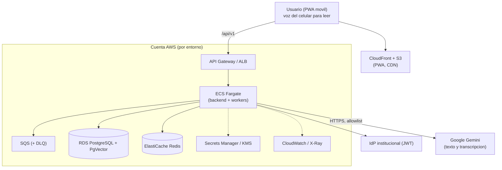
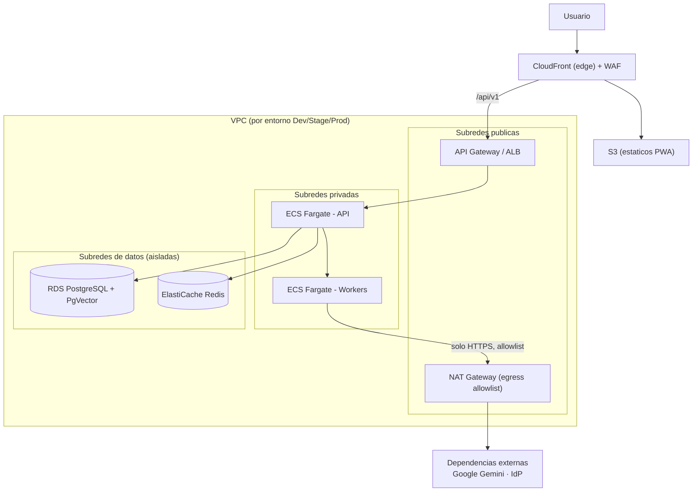
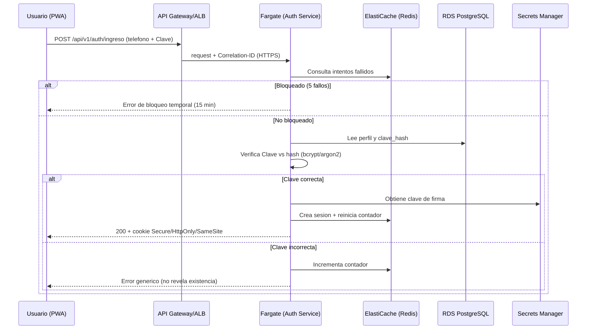

# Arquitectura en AWS — CIMA (plataforma educativa)

Vista de infraestructura de CIMA sobre servicios de AWS. Mapea la arquitectura lógica
(`docs/ARCHITECTURE.md`) a servicios gestionados. CIMA es una **plataforma educativa**:
**no procesa pagos ni emite pólizas**.

> **Propuesta de referencia para la infraestructura.** Los servicios finales de cómputo,
> datos y red los valida TI/Cloud y los gobiernan los steering de IaC (Terraform). Supuestos
> por defecto (ver §7): cómputo **ECS Fargate**. La IA **ya está decidida**: el estándar
> corporativo es **Google Gemini** (API de Gemini con key de Google AI Studio, cubierta por
> el acuerdo corporativo de no entrenamiento con nuestros datos). La voz del asistente la
> pone el **celular** (Web Speech API). Ver §2.1.

## 1. Principios que se preservan

- **Separación de capas:** S3/CloudFront sirve la PWA; la lógica vive en Fargate; la BD solo
  se accede desde el backend dentro de la VPC.
- **Seguridad por diseño:** RDS/Redis en subredes privadas; egress controlado (SSRF);
  secretos en Secrets Manager; cifrado at-rest (KMS) y TLS.
- **AI First responsable:** redacción de PII y guardrails en el backend antes del modelo.
- **Resiliencia:** SQS para asíncrono y reintentos (DLQ); escalado horizontal sin estado.
- **Entornos Dev/Stage/Prod separados.**

## 2. Mapeo de componentes → servicios AWS

| Componente CIMA | Servicio | Rol | Req |
|---|---|---|---|
| PWA Angular (estáticos) | **S3 + CloudFront** | Hosting PWA, CDN, HTTPS, compresión | R2, R13 |
| API Gateway | **Amazon API Gateway** / **ALB** | Entrada, rate limiting, enrutado `/api/v1` | R11, R12 |
| Backend FastAPI (sin estado) | **ECS Fargate** | Servicios de dominio, escalado horizontal | R12 |
| Workers async (IA, STT) | **ECS Fargate (worker)** | Procesamiento en background | R3, R12 |
| Cola de mensajes | **Amazon SQS** (+ DLQ) | Inferencia asíncrona, reintentos | R3, R8 |
| PostgreSQL 15+ con PgVector | **Amazon RDS / Aurora PostgreSQL** | Relacional + similitud (adaptativo) | R4, R17 |
| Sesión / rate limit / lockout | **Amazon ElastiCache (Redis)** | Sesión compartida, TTLs | R1, R12 |
| Secretos (incluida la key de Gemini) | **AWS Secrets Manager** / SSM | Credenciales; nunca en código | R9, R11 |
| Logging / métricas / tracing | **CloudWatch + X-Ray** (o Datadog) | Logs, SLOs, Correlation-ID | R11 |
| LLM | **Google Gemini** (externo, `generativelanguage.googleapis.com`) | Asistente de IA (sin PII) | R3, R16 |
| STT (notas de voz) | **Google Gemini** (externo, misma key) | Voz a texto con salvaguardas | R14 |
| TTS (leer respuestas y páginas) | **Celular del Usuario** (Web Speech API) | Texto a voz sin datos ni servidor | R13, R14 |
| Audio de notas de voz | **No se guarda** | Solo viaja en la llamada de transcripción | R14 |
| Videos de las microcápsulas | **S3 + CloudFront** (pendiente) | Video propio servido con sesión | R4 |
| Data Operativa (GraphQL) | **AppSync** + **S3/Athena** | Agregados del Tablero ODS | R15 |
| Retención 90 días | **EventBridge + Lambda** | Eliminación/anonimización de PII | R8, R9, R20 |
| Cifrado | **AWS KMS** | At-rest para RDS, S3, Secrets | R9 |
| IdP institucional (JWT) | **externo** (por contrato) | No se reemplaza | R1, R10 |

> No hay servicios de pagos ni integración con core de pólizas: fuera del alcance.

### 2.1 Decisión de IA: Gemini

- **Modelo de texto:** `gemini-3.8-flash` con razonamiento bajo (`GEMINI_THINKING_LEVEL=low`,
  ~3,6 s de mediana). Adaptador propio sobre la API REST con `httpx`, sin SDK
  (`backend/app/chat/gemini.py`). Instrucciones `system`/`developer` en `systemInstruction`
  y el texto del Usuario solo en `contents` (OWASP LLM01).
- **Transcripción de notas de voz:** `gemini-3.5-flash-lite` con salida estructurada que
  primero describe lo que se escucha (`backend/app/chat/gemini_stt.py`, PR #93). Gemini no
  entrega confianza, así que hay tres salvaguardas: el celular no envía notas en silencio,
  el servidor descarta lo que no tenga voz y el Usuario ve lo que se entendió.
- **Voz del asistente:** la del celular (Web Speech API, prefiere es-CO). No consume datos,
  funciona sin conexión y no envía nada a un servidor. Se descartó la voz de Gemini (WAV de
  560–730 KB por respuesta).
- **Seguridad de la integración:** la key va en Secrets Manager (en local, solo en
  `backend/.env`), viaja solo en la cabecera `x-goog-api-key`, el egress pasa por el cliente
  con control de SSRF (HTTPS, allowlist con `generativelanguage.googleapis.com`, sin
  redirecciones) y la respuesta se valida antes de usarla. Si Gemini no está configurado o
  falla, el backend cae a un respaldo seguro.
- **Pendiente:** LLM Observability de Datadog; consentimiento de Habeas Data para voz real
  (Jurídica); Cloud Speech-to-Text como alternativa de STT cuando TI dé permisos a la cuenta
  de servicio de GCP.

## 3. Contexto en AWS



## 4. Despliegue en VPC (subredes públicas / privadas / datos)



- RDS y Redis en subredes aisladas, sin ruta a internet.
- Egress solo por NAT con allowlist y bloqueo de IPs privadas (SSRF, R10). Para la IA basta
  permitir `generativelanguage.googleapis.com`.

## 5. Flujo asíncrono del asistente de voz sobre AWS

```mermaid
sequenceDiagram
    participant U as Usuario (PWA)
    participant GW as API Gateway/ALB
    participant API as Fargate (API)
    participant STT as Gemini (transcripcion)
    participant SQS as SQS
    participant WRK as Fargate (Worker)
    participant G as Guardrails + Redaccion PII
    participant LLM as Gemini (texto)

    U->>U: Mide el microfono (no envia silencio)
    U->>GW: Nota de voz
    GW->>API: request + Correlation-ID
    API->>STT: Audio (no se guarda)
    STT-->>API: Lo que se escucha + texto
    API->>API: Confianza derivada; si duda, pide repetir
    API->>SQS: Encola inferencia (texto redactado)
    API-->>U: 202 + lo que se entendio
    SQS->>WRK: Entrega
    WRK->>G: Redacta PII + guardrails
    G->>LLM: Prompt sin PII
    LLM-->>G: Respuesta educativa
    G-->>U: Texto (log sin PII)
    U->>U: Lee la respuesta con la voz del celular
    Note over SQS: Reintentos y DLQ
```

## 6. Flujo de login sobre AWS

El login lo maneja el **Auth Service** (ECS Fargate), no un servicio separado. Participan:
API Gateway (HTTPS, rate limit), Fargate (lógica), RDS (perfil + `clave_hash`), ElastiCache
(sesión e intentos) y Secrets Manager (clave de firma de tokens).



- **RDS** guarda la Clave solo como hash; **ElastiCache** guarda sesión, contador de intentos
  y bloqueo (con TTL); **Secrets Manager** provee la clave de firma de los tokens.
- Cumple el Requirement 1: hash de Clave, bloqueo anti fuerza bruta, tokens cortos con
  rotación en cookies seguras y errores que no filtran información.

## 7. Supuestos y alternativas (a validar por TI/Cloud)

| Decisión | Por defecto | Alternativa |
|---|---|---|
| Cómputo backend | ECS Fargate | EKS si hay estándar Kubernetes |
| LLM | Google Gemini (**decidido**, estándar corporativo) | — |
| STT | Google Gemini con salvaguardas | Cloud Speech-to-Text (pendiente permisos de TI) |
| TTS | Voz del celular (Web Speech API) | — |
| Videos de microcápsulas | S3 + CloudFront (pendiente con TI) | — |
| Entrada | API Gateway | ALB |
| Observabilidad | CloudWatch + X-Ray | Datadog |
| Base de datos | RDS PostgreSQL | Aurora PostgreSQL |

## 8. Trazabilidad

| Artefacto | Ubicación |
|---|---|
| Arquitectura lógica | `docs/ARCHITECTURE.md` |
| Arquitectura en AWS (este doc) | `docs/ARCHITECTURE-AWS.md` |
| Diagrama editable (draw.io) | `docs/cima-aws-architecture.drawio` |
| Diseño técnico | `.kiro/specs/cima-plataforma/design.md` |
| Adaptadores de Gemini | `backend/app/chat/gemini.py`, `backend/app/chat/gemini_stt.py` |
