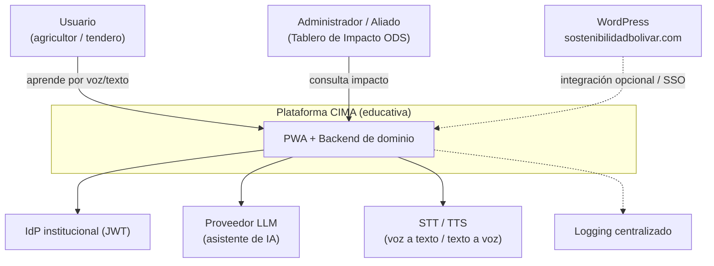
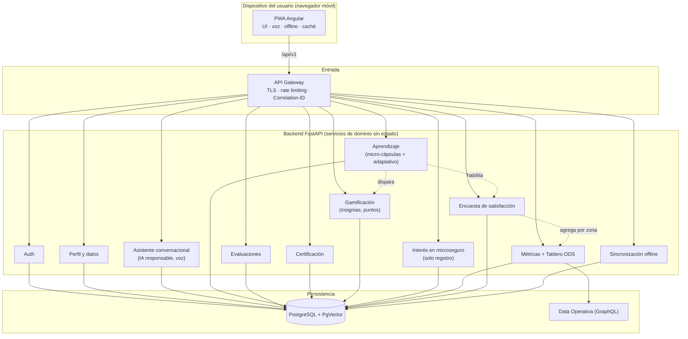
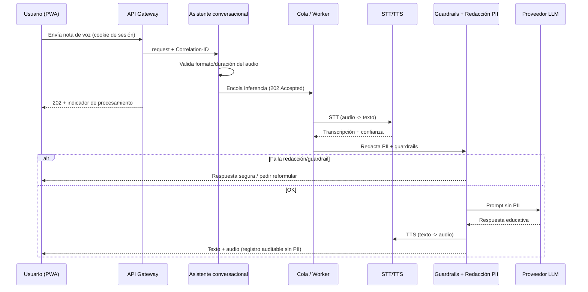
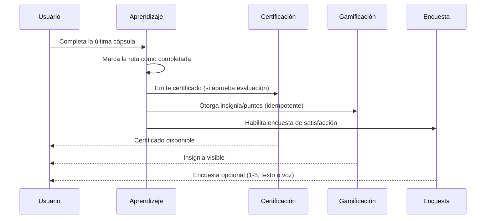
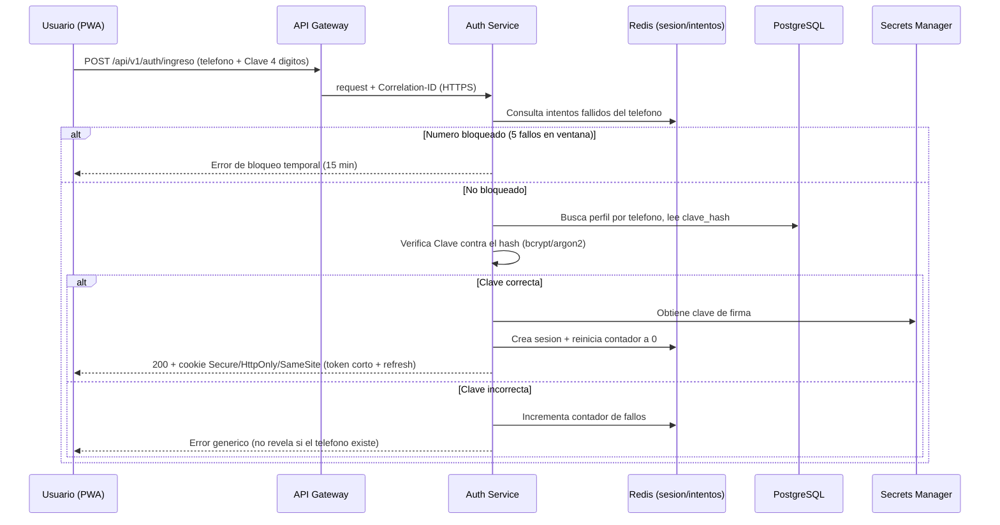
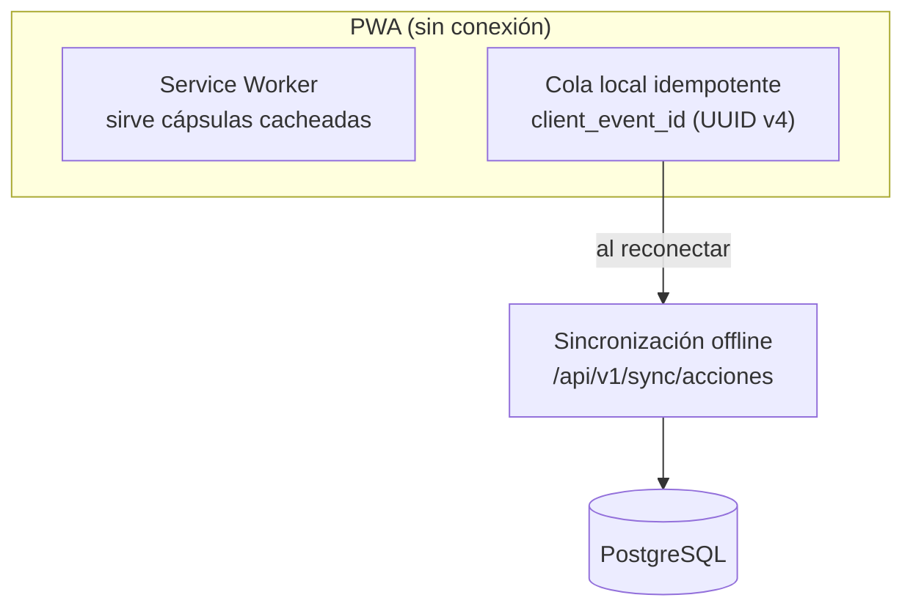

# Arquitectura — CIMA (Conocimiento, Inteligencia, Mercado y Agro)

Documento de arquitectura de **CIMA**, la Escuela de Sostenibilidad e Inclusión Bolívar:
una **plataforma educativa** que forma a agricultores y tenderos colombianos en finanzas,
gestión de riesgos y adaptación al clima, mediante micro-aprendizaje y un asistente de voz.

> Este documento es la vista de arquitectura consolidada y explicada. El detalle formal
> está en `.kiro/specs/cima-plataforma/requirements.md` (el "qué") y `design.md` (el "cómo").

## 1. ¿Qué es CIMA y qué NO es?

CIMA es, ante todo, una **plataforma de formación**. Su propósito es llevar educación
financiera y climática a personas con baja alfabetización digital, en dispositivos de gama
de entrada y con conectividad intermitente.

**Alcance (lo que SÍ hace):**

- Acceso sin fricción (teléfono + Clave de 4 dígitos).
- Micro-aprendizaje personalizado (cápsulas de 3–5 min) con un asistente conversacional por
  voz y texto.
- Evaluaciones, certificación del aprendizaje y gamificación (insignias, puntos).
- Encuesta de satisfacción y métricas de impacto agregadas por zona (ODS).
- Cuando el usuario muestra interés en un microseguro, **registra esa intención** como dato
  para análisis — nada más.

**Fuera de alcance (lo que NO hace):**

- **No procesa pagos.** No hay pasarela de pagos ni cobros.
- **No emite pólizas.** No se integra con ningún core de pólizas ni sistema de aseguramiento.

> En otras palabras: CIMA educa y mide el interés; la comercialización o emisión de productos,
> si ocurre, sucede fuera de esta plataforma y por otros canales.

## 2. Principios de arquitectura

- **Separación estricta de capas:** la PWA solo muestra información; la lógica de negocio y la
  autorización viven en el backend; la base de datos solo se accede vía API.
- **Diseñado para el usuario:** voz-first, pocos pasos, accesible (WCAG 2.1 AA), offline.
- **API First:** rutas versionadas (`/api/v1/`) y OpenAPI como contrato.
- **AI First responsable:** inferencia asíncrona, redacción de PII antes del modelo, guardrails,
  registro auditable sin PII, kill switch.
- **Seguridad por diseño:** validación en servidor, autorización por propiedad del recurso,
  enmascaramiento de PII, cookies httpOnly, SSRF controlado por allowlist.
- **Protección de datos (Habeas Data):** mínimo de datos, retención máxima de 90 días.

## 3. Pila tecnológica

| Capa | Tecnología | Para qué |
|------|-----------|----------|
| Frontend | Angular (LTS) PWA · Service Worker · RxJS | UI, voz, offline, accesibilidad |
| Backend | FastAPI (Python 3.12+) · SQLAlchemy · Pydantic · Alembic | Lógica de negocio, validación, IA |
| Datos | PostgreSQL 15+ · PgVector | Datos relacionales + similitud (aprendizaje adaptativo) |
| Datos operativos | GraphQL (Data Operativa) | Agregados del Tablero de Impacto (ODS) |
| Async | Cola de mensajes + workers | Inferencia de IA, STT/TTS, reintentos, agregación |
| Pruebas | pytest + Hypothesis · Jest + fast-check | Property-based testing |

## 4. Vista de contexto (quién usa CIMA y de qué depende)

> Nota: las dependencias externas son solo las necesarias para **formar** (IdP, LLM, voz) y,
> opcionalmente, WordPress. No hay pagos ni core de pólizas.

## 5. Vista de componentes

### Qué hace cada servicio

| Servicio | Responsabilidad | Requisitos |
|----------|-----------------|-----------|
| Auth | Acceso teléfono + Clave 4 dígitos, sesión, bloqueo, SSO | R1, R10 |
| Perfil y datos | Perfil mínimo, validación, anti-BOLA, retención 90 días | R9 |
| Asistente conversacional | Chat voz/texto, STT/TTS, redacción PII, guardrails, kill switch | R3, R14, R16 |
| Aprendizaje | Selección y adaptación de cápsulas, completitud de ruta | R4, R17 |
| Evaluaciones | Puntaje, reintentos, enfriamiento | R7 |
| Certificación | Emisión idempotente de certificados, autorización por titular | R6 |
| Gamificación | Insignias y puntos idempotentes | R19 |
| Interés en microseguro | **Solo registra la intención del usuario** (sin pago ni emisión) | R5 |
| Métricas + Tablero ODS | Eventos por zona, k-anonimato, impacto ODS | R8, R15 |
| Encuesta de satisfacción | Encuesta breve, validación, idempotencia | R20 |
| Sincronización offline | Sincronización idempotente, fusión de progreso | R18 |

## 6. Flujo clave — Aprender con el asistente de voz

## 7. Flujo clave — Completar una ruta de aprendizaje

## 8. Flujo clave — Login (autenticación sin fricción)

CIMA gestiona su propia autenticación. El **Auth Service** (dentro del backend) valida el
teléfono y la Clave de 4 dígitos, controla intentos, y emite la sesión. La Clave se guarda
**solo como hash**; el contador de intentos y la sesión viven en Redis (rápido, con TTL).

Puntos clave (Requirement 1):

- **La Clave nunca se guarda ni compara en texto plano:** se almacena como hash (bcrypt/argon2)
  y en el login se hashea lo ingresado para comparar hashes.
- **Bloqueo anti fuerza bruta:** 5 intentos fallidos -> bloqueo de 15 min por número; el
  contador y el bloqueo viven en Redis con expiración.
- **Sesión segura:** token de acceso corto (<= 15 min) + refresh rotatorio, en cookie
  `Secure` + `HttpOnly` + `SameSite`. Nunca en `localStorage`.
- **Errores genéricos:** ante Clave incorrecta no se revela si el teléfono existe.
- **Ayuda mnemotécnica:** la pantalla de creación de Clave sugiere usar los últimos 4 dígitos
  de la cédula, pero es solo texto de UI (no se valida ni se almacena la cédula).

## 9. Resiliencia offline

El usuario puede seguir aprendiendo sin internet; al reconectar, su progreso se sincroniza
sin duplicados ni pérdida.

## 10. Seguridad y privacidad (resumen)

| Tema | Mecanismo | Requisitos |
|---|---|---|
| Acceso | Teléfono + Clave 4 dígitos (hash), tokens cortos, cookies httpOnly | R1 |
| Autorización | Verificación de propiedad del recurso en backend (anti-BOLA) | R6, R9, R19 |
| PII / Habeas Data | Enmascaramiento en respuestas y logs; retención 90 días | R8, R9, R20 |
| IA responsable | Redacción de PII antes del modelo, guardrails, kill switch | R16 |
| Datos agregados | Supresión de zonas con < 5 usuarios (k-anonimato) | R8, R15, R20 |

## 11. Trazabilidad

| Artefacto | Ubicación |
|---|---|
| Requisitos (EARS) | `.kiro/specs/cima-plataforma/requirements.md` |
| Diseño técnico detallado | `.kiro/specs/cima-plataforma/design.md` |
| Arquitectura lógica (este doc) | `docs/ARCHITECTURE.md` |
| Arquitectura en AWS | `docs/ARCHITECTURE-AWS.md` |
| Diagrama editable (draw.io) | `docs/cima-aws-architecture.drawio` + `docs/DIAGRAMA-AWS.md` |
| Plan de implementación | `.kiro/specs/cima-plataforma/tasks.md` |
