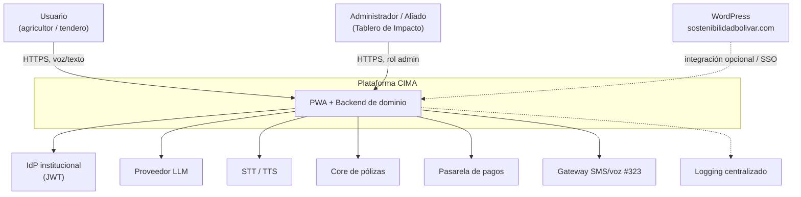
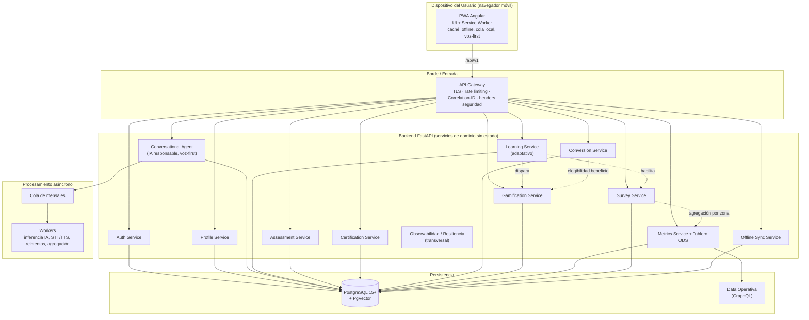
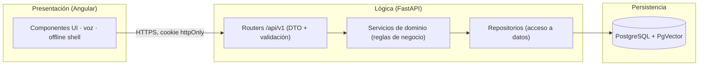
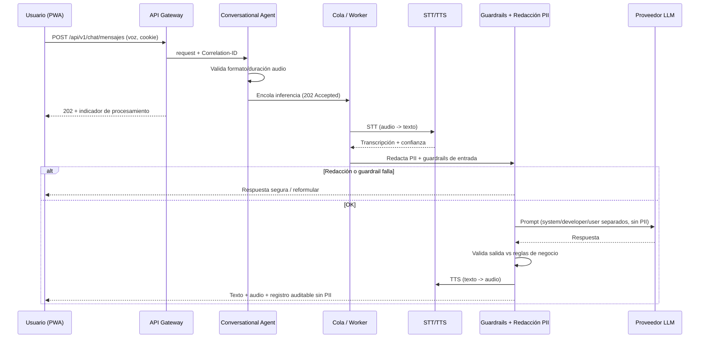
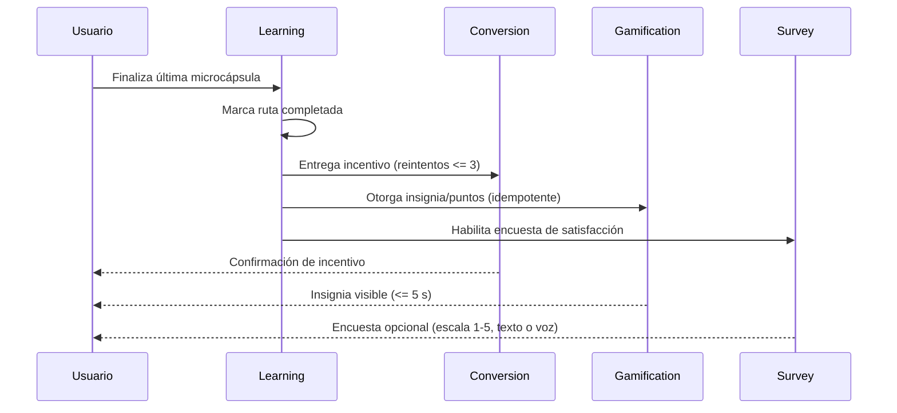
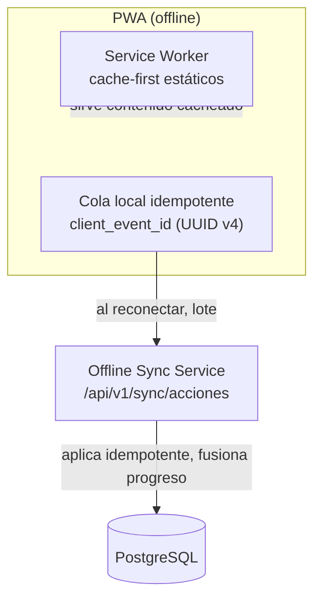
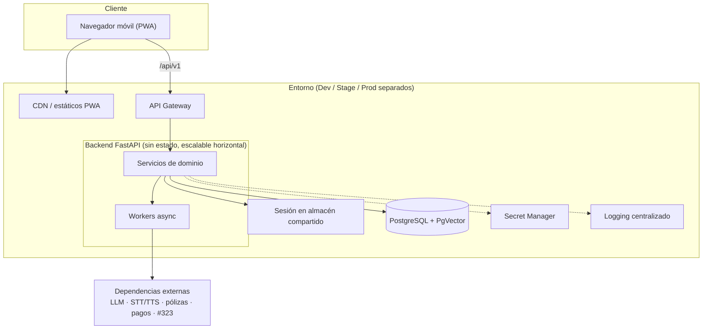

# Arquitectura — CIMA (Conocimiento, Inteligencia, Mercado y Agro)

Documento de arquitectura de la plataforma CIMA, la Escuela de Sostenibilidad e
Inclusión Bolívar. Consolida de forma visual las decisiones del diseño técnico
(`.kiro/specs/cima-plataforma/design.md`) para servir como referencia de alto nivel.

> Fuente de verdad del detalle: `requirements.md` (el "qué") y `design.md` (el "cómo").
> Este documento es una vista arquitectónica consolidada, no reemplaza a ninguno.

## 1. Visión general

CIMA es una **PWA ultraligera** con un **agente conversacional de IA generativa**
(texto y voz) que escala la educación financiera/climática y la conversión a
microseguros para agricultores y tenderos colombianos, en dispositivos de gama de
entrada y conectividad intermitente.

Principios arquitectónicos rectores:

- **Separación estricta de capas:** la PWA solo renderiza; la lógica de negocio y la
  autorización viven en el backend; la persistencia se accede solo vía API.
- **API First:** rutas versionadas (`/api/v1/`), OpenAPI como contrato.
- **AI First:** inferencia asíncrona, redacción de PII antes del modelo, guardrails,
  registro auditable sin PII, kill switch.
- **Seguridad por diseño y Zero Trust Input:** validación en servidor, autorización por
  propiedad del recurso (anti-BOLA), enmascaramiento de PII, cookies httpOnly, SSRF
  controlado por allowlist.
- **Resiliencia:** circuit breakers, timeouts, rate limiting, offline idempotente.
- **Observabilidad:** Correlation-ID, logs estructurados centralizados, SLOs.

## 2. Pila tecnológica

| Capa | Tecnología | Notas |
|------|-----------|-------|
| Frontend | Angular (LTS) PWA · Service Worker · RxJS · `inject()` | Solo UI; offline; voz-first; WCAG 2.1 AA |
| Backend | FastAPI (Python 3.12+) · SQLAlchemy · Pydantic · Alembic | Validación estricta en servidor; inferencia asíncrona |
| Datos | PostgreSQL 15+ · PgVector | Relacional + similitud (aprendizaje adaptativo) |
| Datos operativos | GraphQL (Data Operativa / Data Lake) | Agregados del Tablero de Impacto (ODS) |
| Async | Cola de mensajes + workers | IA, STT/TTS, reintentos, agregación |
| Pruebas | pytest + Hypothesis · Jest + fast-check | Property-based testing (44 propiedades) |

Dependencias ancladas a versión exacta, resueltas desde JFrog. Secretos vía Secret
Manager / variables de entorno.

## 3. Contexto del sistema (C4 nivel 1)

## 4. Contenedores y componentes (C4 nivel 2)

### Mapa de servicios de dominio

| # | Servicio | Responsabilidad | Requisitos |
|---|----------|-----------------|-----------|
| 1 | Auth | Login teléfono + Clave 4 dígitos, tokens, bloqueo, SSO | R1, R10 |
| 2 | Profile | Perfil mínimo, validación, anti-BOLA, retención 90 días | R9 |
| 3 | Conversational Agent | Chat texto/voz, STT/TTS, redacción PII, guardrails, kill switch | R3, R14, R16 |
| 4 | Learning | Selección y adaptación de microcápsulas, completitud de ruta | R4, R17 |
| 5 | Assessment | Evaluaciones, puntaje, reintentos, enfriamiento | R7 |
| 6 | Certification | Emisión idempotente de certificados, autorización por titular | R6 |
| 7 | Conversion | Incentivos y oferta de microseguros | R5 |
| 8 | Gamification | Insignias y puntos idempotentes | R19 |
| 9 | Metrics + Tablero ODS | Eventos por zona, k-anonimato, impacto ODS | R8, R15 |
| 10 | Survey | Encuesta de satisfacción, validación, idempotencia | R20 |
| 11 | Offline Sync | Sincronización idempotente, fusión de progreso | R18 |
| — | Observabilidad/Resiliencia | Correlation-ID, logs, SLOs, circuit breakers (transversal) | R11, R12 |

## 5. Capas y separación de responsabilidades

- **Presentación:** sin reglas de negocio ni autorización; tokens nunca en localStorage.
- **Lógica:** validación (Pydantic), autorización por propiedad, cálculo de puntajes,
  selección/adaptación de contenido, pipeline de IA.
- **Persistencia:** siempre vía repositorios; consultas parametrizadas; PII cifrada.

## 6. Flujo clave — Interacción de voz con IA responsable

## 7. Flujo clave — Completar ruta → incentivo, gamificación y encuesta

## 8. Resiliencia offline

## 9. Seguridad y privacidad (vista transversal)

| Preocupación | Mecanismo | Requisitos |
|---|---|---|
| Autenticación | Teléfono + Clave 4 dígitos (hash), tokens cortos + rotación, cookies Secure/HttpOnly/SameSite | R1 |
| Autorización (BOLA/IDOR) | Verificación de propiedad del recurso en backend en cada request | R6, R9, R19 |
| PII / Habeas Data | Enmascaramiento en respuestas y logs; DTO allowlist; retención/anonimización 90 días | R8, R9, R20 |
| SSRF | Allowlist de dominios, HTTPS, bloqueo de IPs privadas, timeout, límite de redirecciones | R10 |
| IA responsable | Redacción de PII antes del modelo, guardrails, validación de salida, kill switch, transparencia | R16 |
| k-anonimato | Supresión de zonas con < 5 usuarios en reportes agregados | R8, R15, R20 |
| Secretos | Secret Manager / variables de entorno; nunca en código | R9, R11 |
| Cabeceras | HSTS, CSP, nosniff, X-Frame-Options, Referrer-Policy, Permissions-Policy | R11 |

## 10. Despliegue (vista lógica)

- Entornos **Dev / Stage / Prod físicamente separados**.
- Servicios **sin estado** con escalado horizontal; sesión en almacén compartido.
- Comunicación vía **DNS** (no IPs estáticas), solo **HTTPS**.
- **Graceful shutdown**: completar transacciones pendientes antes de cerrar.

## 11. Trazabilidad

| Artefacto | Ubicación |
|---|---|
| Requisitos (EARS) | `.kiro/specs/cima-plataforma/requirements.md` |
| Diseño técnico detallado | `.kiro/specs/cima-plataforma/design.md` |
| Plan de implementación | `.kiro/specs/cima-plataforma/tasks.md` |
| Este documento (vista consolidada) | `docs/ARCHITECTURE.md` |
